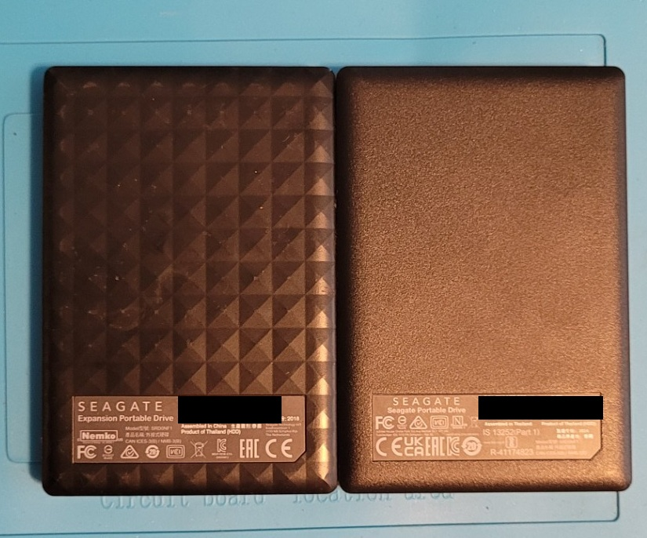

# Backup Storage: Media Copied to Two External Drives

Two USB-powered portable 2TB Seagate drives that hold my media files. After the 4TB drive that came with my [homelab server](../server/README.md) failed its health check, I made sure the media exists on two separate drives.

## Drives

| Label | Drive | Role | Contents |
|---|---|---|---|
| A | Seagate Expansion 2TB portable external HDD, USB-powered | Media original | About 560GB of media |
| B | Seagate Portable Drive 2TB external HDD (part number 2N1AP5-500), USB-powered | Media backup | A `Media Backup` folder with a copy of drive A's media |

I worked out the sizes from what Windows showed: about 1.25TB free on drive A and about 1.25TB free on drive B, on drives that display about 1.81TB in total.

## Why

I had planned to move the media onto the server's 4TB drive. Its S.M.A.R.T. health check failed, so I never put anything on it (see the [server write-up](../server/README.md)). The media was still on drive A alone, so I copied it to drive B.

## What I did

1. Checked that drive B had enough free space for the media.
2. Created a folder named `Media Backup` on drive B and **copied** (not moved) everything from drive A into it. Windows estimated about 2.5 hours.
3. Verified the copy by comparing the Properties of both locations. The total size and the file and folder counts matched.

## Limits

- This protects against one drive failing, and nothing more. Both are portable drives, and I have no third copy offsite.
- The copy is a snapshot from the day I made it. New files on drive A aren't copied to drive B automatically.
- I haven't checked the S.M.A.R.T. health of either Seagate drive yet.
- Neither drive is free for reuse, because each one holds a copy of the media. My later backup and restore project will need separate storage.

## Related projects

- [Proxmox homelab server](../server/README.md)
- [Custom-built PC](../custom-pc/README.md), which I used to make and check the copy
