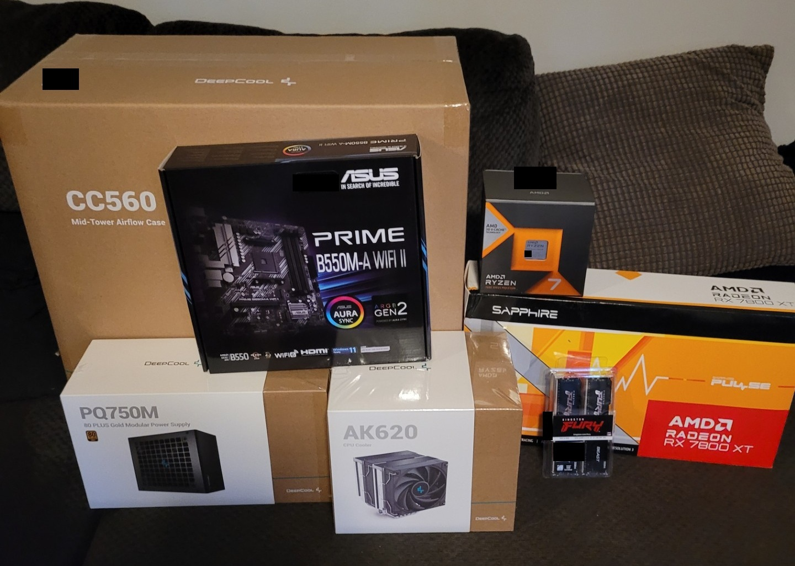
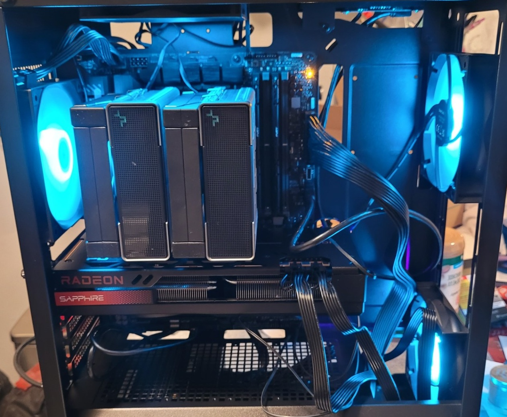

# Custom-Built PC: Ryzen 7 7800X3D Gaming and Admin Workstation

A mid-range gaming PC I built to play games and learn to code. It is also the admin workstation I use to manage my [Proxmox homelab server](../server/README.md) through its web interface.

**This write-up is retrospective.** I built the PC a couple of years ago. The specs were read from the running machine in October 2026. The rest comes from my memory, a photo I took the day the parts arrived, and a photo of the PC running the day I built it.

## Specs

| Component | Details |
|---|---|
| CPU | AMD Ryzen 7 7800X3D, 8 cores / 16 threads |
| CPU cooler | DeepCool AK620 (air cooler) |
| Motherboard | ASUS TUF GAMING X670E-PLUS WIFI (BIOS version 1616, dated 2023-05-16) |
| Memory | 32GB DDR5 (2x16GB Kingston FURY Beast, part number reported as KF560C36-16). Rated 6000 MT/s CL36, currently running at 4800 MT/s |
| Graphics | Sapphire Pulse Radeon RX 7800 XT, 16GB |
| Storage | Crucial P3 Plus 2TB NVMe SSD (CT2000P3PSSD8), M.2 2280, PCIe 4.0 |
| Power supply | DeepCool PQ750M, 750W, 80 PLUS Gold, modular |
| Case | DeepCool CC560 mid-tower airflow case, case fans included |
| Operating system | Windows 11 Home, version 25H2 (OS build 26200.9711), read October 2026 |

## Why I chose each part

| Part | Reason |
|---|---|
| CPU | I wanted a high mid-range PC for gaming and learning to code. I picked AMD over Intel partly because I had read that AMD keeps the same socket across more processor generations, which makes a later CPU upgrade possible without replacing the motherboard. |
| Motherboard | After returning an incompatible board (see below), I exchanged it for this one after reading positive reviews, and chose ASUS for its reputation for reliability. It uses the AM5 socket and DDR5 memory, which match the CPU and RAM. |
| Memory | Good price and Kingston's reputation. DDR5 is the memory type the AM5 board requires. |
| Graphics | A higher-end card, though not the top of the range, at a good price for its class. |
| Storage | Recommended by a store employee who used the same drive in his own build. I was weighing a much cheaper drive to save money. |
| CPU cooler | Recommended by a store employee who used it in his own build. |
| Power supply | It was on sale and had good online reviews. |
| Case | Inexpensive, came with case fans, and I liked how it looked. |

## Problems and fixes

**Incompatible motherboard.** I first bought an ASUS PRIME B550M-A WIFI II on a store employee's recommendation, without checking compatibility. It's an AM4 board that takes DDR4 memory, and my Ryzen 7 7800X3D needs the AM5 socket and DDR5 memory, so it wouldn't have worked. I returned it and exchanged it for the ASUS TUF GAMING X670E-PLUS WIFI. The photo below, taken the day the parts arrived, shows the wrong board next to the CPU box.

No other problems came up during assembly. The PC powered on and ran the same day I built it.

## What I'd change

I would decide on the motherboard myself, checking its socket and memory type against the CPU, instead of relying on a recommendation. I'm otherwise happy with the build, and the case, power supply, and cooler were good deals.

## Things to look at later

- Turn on the EXPO memory profile in the BIOS. The memory runs at 4800 MT/s, below its 6000 MT/s rating.
- Decide whether a newer BIOS is worth installing. Mine is dated 2023-05-16.

## Related projects

- [Proxmox homelab server](../server/README.md), which I manage from this PC
- Backup storage: [external drives](../backup-storage/README.md)

*Serial numbers and labels have been covered in the images.*
