# Endpoint management on Windows Server (DC01)

**Status:** Parts 1 to 3 are built and tested. Part 4 (imaging) is skipped for now. | **Built:** 2026-11-14 to 2026-11-18

## Goal

Manage a Windows 11 client from the domain controller: control how it takes Windows updates, install software on it without touching it, and run my own update server (WSUS) for it. The first two use Group Policy, the third adds a WSUS server. All of it is tested on a domain-joined client.

## Scope: what changed from my plan

My plan listed WSUS, WDS and MDT. Before building anything I checked their status in November 2026. The sources were news and documentation pages I found by search, not all from Microsoft, so treat the details as unverified:

* **WSUS** is deprecated but still works on Windows Server 2025.
* **MDT** was retired in January 2026, and its downloads were pulled.
* **WDS** still works for now, but Microsoft has said the whole role will be deprecated starting with the next major Windows Server release. Its older WDS-mode way of deploying Windows 11 was deprecated in 2021, although deploying custom images over PXE stayed possible.

So I split the project into parts:

| Part | What | Status |
| --- | --- | --- |
| 1 | Windows Update settings through Group Policy | Done |
| 2 | Software deployment through Group Policy | Done |
| 3 | WSUS | Done |
| 4 | Imaging | Skipped for now. WDS is being deprecated, MDT is retired, and I don't yet know which replacement is most used in business. I'll come back to it. |

## Environment

* **DC01:** Windows Server 2025 Standard (evaluation) in a Proxmox VM, domain `homelab.internal`. See the [Proxmox server](../server/) page for the host, which now has 32GB of RAM.
* **client01:** Windows 11 Enterprise (evaluation, 26H2), joined to the domain and in the `Lab > Computers` OU.
* **wsus01:** Windows Server 2025 Standard (evaluation) in a Proxmox VM, a domain member in the `Lab > Servers` OU. Built in Part 3.
* The policies below are linked to `Lab > Computers`, next to my logon banner policy from the [Windows Server and Active Directory project](../windows-server-ad/).

## Part 1: Windows Update through Group Policy

### Design

One policy, `Lab-Computer-Windows-Update`, with three settings. I did not point the client at a WSUS server in this part, because Part 3 adds that.

| Setting | Value |
| --- | --- |
| Configure Automatic Updates | Enabled, option 4 (auto download and schedule the install), every day at 03:00, "install during automatic maintenance" off |
| Deadline for quality updates | 3 days, 2-day grace period |
| Deadline for feature updates | 7 days, 2-day grace period |

I chose option 4 because Microsoft's guidance warns that the options that wait for the user can end in a forced restart at the deadline with no warning. The deadline values follow Microsoft training material (7 days for feature updates, 3 for quality, 2 for the grace period). The editor's own defaults were different: 7 and 2 for quality, and 2 and 7 for feature. I don't know why the feature defaults are reversed.


### What I did

1. Took a Proxmox snapshot of DC01 (`before_updatepolicy`).
2. Created the policy and linked it to `Lab > Computers`.
3. Found the settings under Computer Configuration > Administrative Templates > Windows Components > Windows Update > Manage end user experience, and set the three values.
4. Made a settings report to check every value on one page.
5. On client01, ran `gpupdate /force` and checked the result three ways.
6. Took a second snapshot (`after_updatepolicy`).

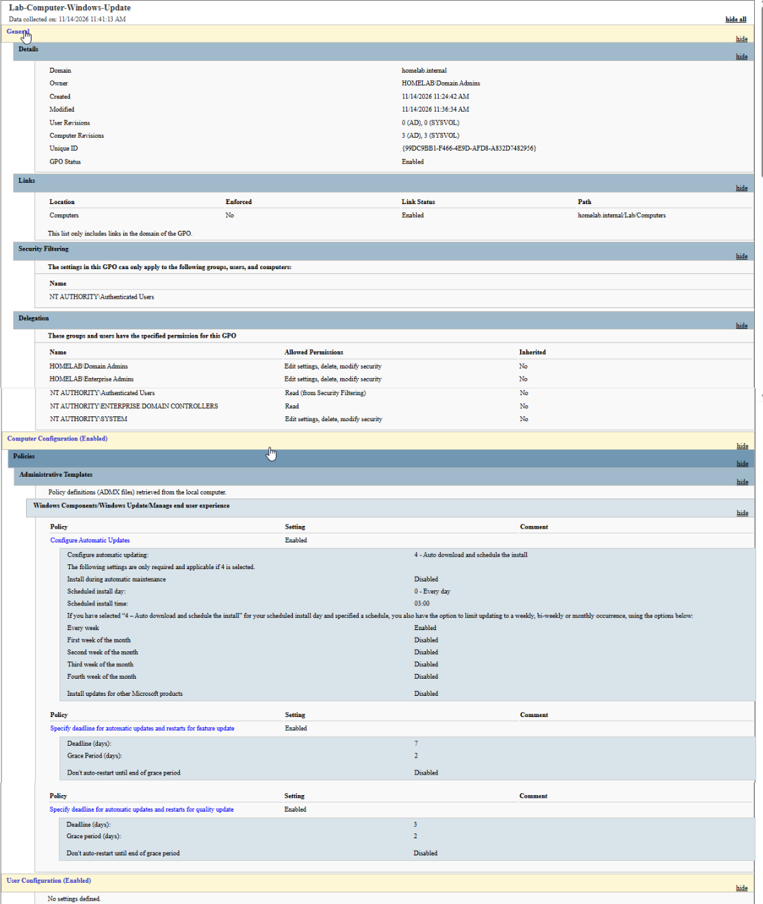

### Checking it worked

```powershell
gpupdate /force
gpresult /scope computer /r
reg query "HKLM\SOFTWARE\Policies\Microsoft\Windows\WindowsUpdate" /s
```

`gpresult` listed `Lab-Computer-Windows-Update` as applied. The registry on client01 held every value I set:

| Setting | Stored value |
| --- | --- |
| Quality deadline 3 days | `ConfigureDeadlineForQualityUpdates` = 0x3 |
| Quality grace period 2 days | `ConfigureDeadlineGracePeriod` = 0x2 |
| Feature deadline 7 days | `ConfigureDeadlineForFeatureUpdates` = 0x7 |
| Feature grace period 2 days | `ConfigureDeadlineGracePeriodForFeatureUpdates` = 0x2 |
| Option 4 | `AUOptions` = 0x4 |
| Every day | `ScheduledInstallDay` = 0x0 |
| 03:00 | `ScheduledInstallTime` = 0x3 |


Windows 11 also lists the policies itself, under Settings > Windows Update > Advanced options > Configured update policies. All eight entries appeared with `Type: Group Policy`.

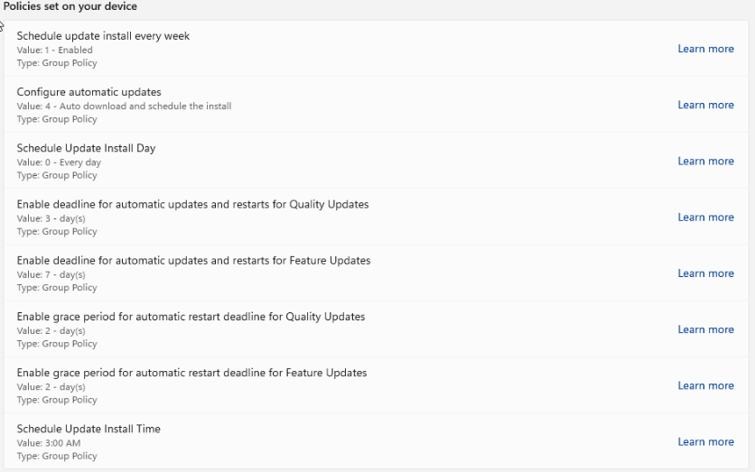

### What went wrong and what I learned

* **The report tab in Group Policy Management was blocked.** Windows Server's Internet Explorer Enhanced Security Configuration blocked the Settings tab, which draws a web page. I didn't loosen the security setting. I made the same report as a file with `Get-GPOReport -Name "Lab-Computer-Windows-Update" -ReportType Html -Path "$env:TEMP\wu-report.html"` and opened it in a browser.
* **I ran the client checks on the wrong machine.** `gpupdate` and `gpresult` ran on DC01, and the list showed the Default Domain Controllers Policy, which only applies to domain controllers, and not my Lab policies. `hostname` confirmed it. Lesson: check `hostname` before running anything with two similar consoles open.
* **A one-word path typo.** My first `reg query` left out `Windows\` in the path and returned "unable to find the specified registry key". The same kind of slip as an earlier `Share` and `Shares` error in the file server project.
* **No "managed by your organization" banner.** The Settings page showed nothing, even after reopening it. A forum post said Windows 11 doesn't show that message, and the policy list under Advanced options is where it shows the policies. I haven't confirmed that with a Microsoft page.

## Part 2: Software deployment through Group Policy

### Design

Group Policy can install programs on a computer when it starts, if the installer is an MSI and sits on a network share the computer can read.

* **A new share:** `\\DC01\Software` (folder `C:\Shares\Software`). Domain Computers get read access, because the install runs under the computer's own account before anyone signs in. IT-Admins get full control, so I can copy installers in. Staff and Help-Desk have no access.
* **The test program:** Firefox ESR, 64-bit MSI, version 153.7.0, from Mozilla's enterprise download page. I first planned 7-Zip, but the newest release appeared to offer only an exe installer, with MSI files only for older versions, and I didn't want to deploy an old version on purpose.
* **A policy:** `Lab-Computer-Software-Deployment`, linked to `Lab > Computers`, with Firefox assigned under Computer Configuration > Software Settings > Software installation. I used the network path of the installer, not a local one.

| Level | Domain Computers | IT-Admins |
| --- | --- | --- |
| Folder permission (NTFS) | Read and Execute | Full control |
| Share permission | Read | Full access |

### What I did

1. Took snapshots before starting (`before_softwaredeploy` on client01, and `after_updatepolicy` on DC01 as the baseline).
2. Created the folder, set its permissions and shared it:

   ```powershell
   New-Item -Path C:\Shares\Software -ItemType Directory
   icacls C:\Shares\Software /grant "HOMELAB\Domain Computers:(OI)(CI)RX" "HOMELAB\IT-Admins:(OI)(CI)F"
   New-SmbShare -Name "Software" -Path "C:\Shares\Software" -ReadAccess "HOMELAB\Domain Computers" -FullAccess "HOMELAB\IT-Admins"
   ```

3. Downloaded the Firefox MSI on client01 and copied it into the share.
4. Created the policy, linked it to `Lab > Computers`, and added the package as **Assigned**.

   

5. On client01, ran `gpupdate /force`. Software installation can only be applied at startup, so Windows warned that a restart was needed and asked to restart.

   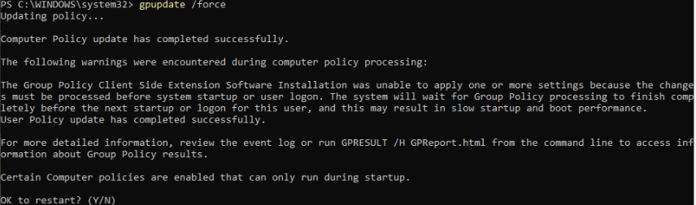

6. Restarted. Firefox did not install (see below). I added the "Always wait for the network at computer startup and logon" setting to the same policy, ran `gpupdate /force`, and restarted again. Firefox then appeared.
7. Took snapshots of both VMs (`after_softwaredeploy`).

### Checking it worked

I made a Group Policy report on client01 with `gpresult /scope computer /h "$env:TEMP\sw-report.html" /f`. The Component Status table showed Software Installation as **Success**, and the report listed Mozilla Firefox 153.7.0esr as installed by `Lab-Computer-Software-Deployment` from the share. I read the installed version from the list Windows keeps in the registry:

```powershell
Get-ItemProperty "HKLM:\SOFTWARE\Microsoft\Windows\CurrentVersion\Uninstall\*","HKLM:\SOFTWARE\WOW6432Node\Microsoft\Windows\CurrentVersion\Uninstall\*" -ErrorAction SilentlyContinue | Where-Object { $_.DisplayName -like "*Firefox*" } | Select-Object DisplayName, DisplayVersion
```

It returned `Mozilla Firefox ESR (x64 en-US)`, version `153.7.0`, matching the package.

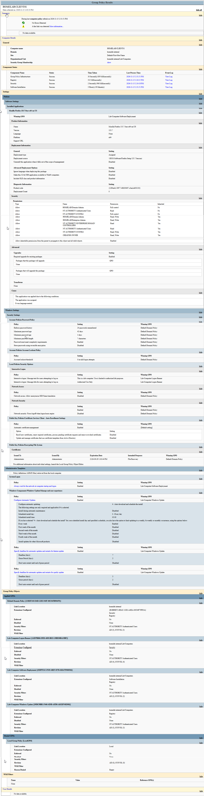

### What went wrong and what I learned

* **The Package dialog couldn't open the share.** I was signed in to DC01 as the built-in `Administrator`, which isn't in IT-Admins. The `Software` share only lists Domain Computers and IT-Admins, so it refused with "You do not have permission to access". I confirmed the account with `whoami`, signed in as `lab.admin` (an IT-Admins member) and the dialog opened. Lesson: share permissions apply to the account you use, even an administrator.

  

* **The first restart didn't install Firefox.** The Component Status table showed Software Installation as **Pending**, with a note that a restart was required. Client01 had started after the time shown in that row, so startup hadn't processed it. I added the wait-for-network setting and restarted again, and the install worked. I changed two things at once, the setting and a second restart, so I can't say which one fixed it.

  

* **No install record in the event log.** `Get-WinEvent` for the `Application Management` provider found no events, even after the install had worked. I don't know why. (My first attempt misspelled the provider name, which gave a different error.)

### Observations I didn't follow up

* The Component Status table showed a Software Installation time of 3 hours 29 minutes, and an earlier report showed 1 hour 20 minutes for another row. Processing doesn't take hours. I suspect a clock jump or time sync problem on the VM, but I haven't checked.

## Part 3: WSUS (Windows Server Update Services)

### Design

**A separate server.** I built a new VM, `wsus01`, and did not put WSUS on the domain controller. A critical WSUS remote code execution flaw (CVE-2025-59287) was disclosed in October 2025. I read about it in news and security sites, not all from Microsoft. A web-facing service with that kind of history doesn't belong on the machine that holds every account in the domain. DC01 also only has 4GB of RAM and an 80GB disk, and the RAM upgrade gave the host room for another VM. Two rules for the build: patch the VM fully before adding the WSUS role, and never forward ports 8530 or 8531 on the home modem.

**The VM:**

| Item | Value |
| --- | --- |
| OS | Windows Server 2025 Standard Evaluation (Desktop Experience), from the 26100 evaluation ISO |
| Hardware | 2 cores (host CPU type), 8GB RAM, 120GB thin-provisioned disk on the `vmdata` pool, UEFI, virtual TPM 2.0, VirtIO disk and network, QEMU guest agent |
| Network | Fixed `192.168.1.55/24`, gateway `192.168.1.254`, DNS `192.168.1.50` (DC01 only) |
| Active Directory | Domain member in a new `Lab > Servers` OU |

**A new OU.** `Lab > Servers` keeps `wsus01` out of `Lab > Computers`, so the Firefox install and the client update policies never apply to it.

**WSUS choices:**

| Choice | Value | Reason |
| --- | --- | --- |
| Update source | Microsoft Update | It's my only WSUS server |
| Languages | English only | Smaller download |
| Product | Windows 11 only (the plain entry) | The versioned entries cover drivers, and some driver packages are about 1 GB |
| Classifications | Critical Updates and Security Updates | Definition Updates was ticked by default, and I unticked it, because it would add a stream of small updates |
| Sync | Manual, with no sync at the end of the wizard | I wanted to take a snapshot first and watch the first sync |
| Update files | Stored in `C:\WSUS`, downloaded when an update is approved | A lab shortcut: a real server would use a separate data drive |

### What I did

1. Checked free space on the VM storage pool (about 154 GB used of 980 GB), then created the VM in Proxmox.
2. Installed Windows Server, loading the VirtIO disk driver from the driver ISO during setup, then the VirtIO guest tools.
3. Gave `wsus01` a fixed address and pointed its DNS at DC01. I pinged the address first to check nothing used it, and tested `nslookup dc01.homelab.internal`, which DC01 answered.
4. Created the `Lab > Servers` OU on DC01 (`New-ADOrganizationalUnit -Name "Servers" -Path "OU=Lab,DC=homelab,DC=internal"`) and confirmed it with `Get-ADOrganizationalUnit`.

   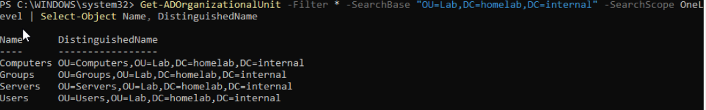

5. Joined `wsus01` to the domain and renamed it (see below), then confirmed its account is in `Lab > Servers` with `Get-ADComputer wsus01`.

   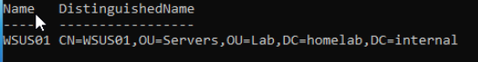

6. Took a snapshot (`after_domainjoin`), then patched the server fully (see below) and took another (`after_patching`).
7. Installed the WSUS role, made a folder for the update files and ran the post-install setup:

   ```powershell
   Install-WindowsFeature -Name UpdateServices -IncludeManagementTools
   New-Item -Path C:\WSUS -ItemType Directory
   & "C:\Program Files\Update Services\Tools\wsusutil.exe" postinstall CONTENT_DIR=C:\WSUS
   ```

   The install reported Success `True` and Restart Needed `No`, and the post-install setup completed.

   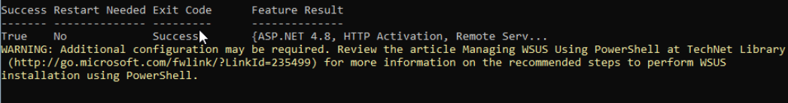

8. Went through the WSUS configuration wizard with the choices above, took a snapshot (`after_wsus_setup`), and started the first sync by hand.
9. Looked at what the sync had downloaded, then created the `Lab-Computer-WSUS` policy and linked it to `Lab > Computers`.
10. Pointed client01 at WSUS, made a `Lab-Clients` group, moved client01 into it, and approved one update for that group.
11. Took snapshots of the three VMs (`after_wsus_tested` on `wsus01`, `after_wsus_policy` on DC01, `after_wsus_client` on client01).

### The update catalog

The first sync succeeded. I didn't record how long it took. The Windows 11 product pulled in **441 updates** (436 shown with the console's default filter, and I don't know why five are hidden), all classified as Security Updates, from 2022 to 2026, for several Windows 11 versions and for both x64 and ARM64. So the plain Windows 11 product covers every version, and updates have to be approved one at a time and not in bulk. A search for 26H2, the version client01 runs, found 10 updates, including the 2026-09, 2026-10 and 2026-11 cumulative updates for x64 and ARM64.

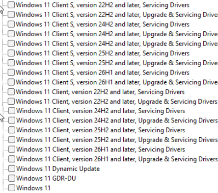
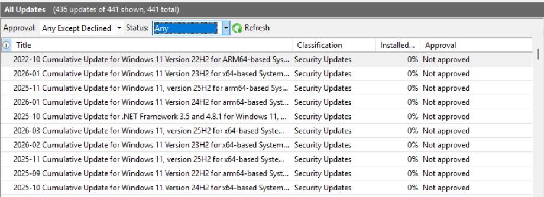
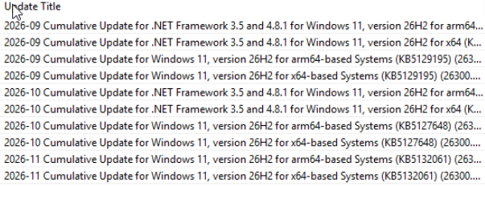

### The policy

`Lab-Computer-WSUS` is its own policy, not another setting in the update policy, so I can switch WSUS on and off for client01 without touching the schedule and deadlines. It sets "Specify intranet Microsoft update service location" under Computer Configuration > Administrative Templates > Windows Components > Windows Update > Manage updates offered from Windows Server Update Service. I confirmed the port with `Get-WsusServer | Select-Object Name, PortNumber` (8530).

| Box | Value |
| --- | --- |
| Intranet update service for detecting updates | `http://wsus01.homelab.internal:8530` |
| Intranet statistics server | `http://wsus01.homelab.internal:8530` |
| Alternate download server | Empty |

The address uses `http`, not `https`, because I didn't set up encryption.

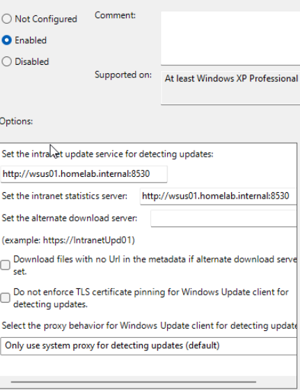

### Checking it worked

On client01, I ran `gpupdate /force` and read the registry again. It held `WUServer` and `WUStatusServer` (both `http://wsus01.homelab.internal:8530`) and `UseWUServer` = 0x1 under `AU`, plus every Part 1 value, so the two policies work together.

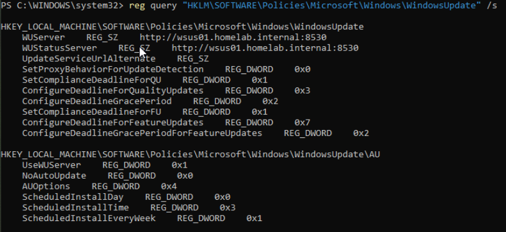

Windows Update on client01 said "up to date". That didn't prove it was talking to WSUS, so I looked in the WSUS console. client01 was listed (I had to set the Status filter to Any), which only happens once a computer has reported in. I made a `Lab-Clients` computer group and moved client01 into it by hand with Change Membership.

Next I approved the 2026-11 cumulative update for x64 (KB5132061) for `Lab-Clients` only. The Download Status page showed one update needing files, then bytes going up, then none needed, so WSUS fetched the update file after approval and not before. That matches how I understand the default setting, which I haven't looked at. After client01 scanned again, WSUS showed the update as **100% installed/not applicable**, and client01's **Last Status Report** was 11/18/2026 11:06 AM.

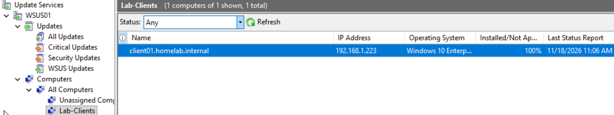
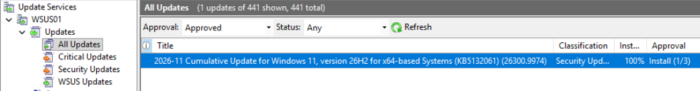

### What this did and didn't prove

client01's build is 26300.9974, the same build as in the title of KB5132061, so it already had the November update. It must have installed it from Microsoft before I pointed it at WSUS. So WSUS had nothing to deliver. The 100% column combines "installed" and "not applicable", and it doesn't say which, but the matching build makes "installed" almost certain. What I did show is that client01 takes its settings from the WSUS policy, registers with the server, sits in the right group, and reports its status after an approval. I did **not** show WSUS delivering an update that client01 was missing. The next chance is Microsoft's December update, around December 8 (the second Tuesday).

### What went wrong and what I learned

* **A missed boot prompt.** The new VM showed a boot device menu, and my first attempts to boot from the Windows disc dropped back to it. The "press any key" prompt only stays up for a few seconds, and I wasn't pressing a key fast enough. The disc I'd tried first was the right one all along. Lesson: tap a key repeatedly as soon as the console comes up.
* **The domain join half-worked.** My first `Add-Computer` failed with "Cannot validate argument on parameter 'Credential'. The argument is null or empty", because the password pop-up never appeared in the console. I collected the password in the console instead (`Read-Host -AsSecureString`) and built the credential from it. The second attempt joined the domain but failed to rename the server, with "The directory service is busy". `Rename-Computer -NewName "wsus01" -DomainCredential $cred -Restart` then worked. I don't know why the directory service was busy.

  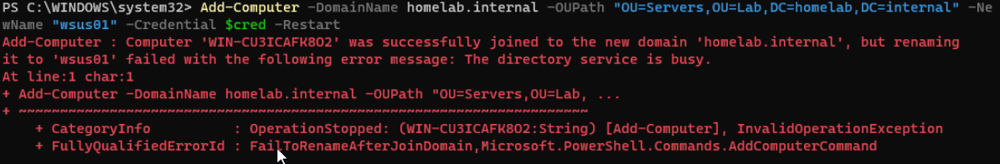

* **Patching looked stuck and wasn't.** The server had five updates waiting, including the 2026-11 security update (KB5131080), which takes Windows Server 2025 to build 26100.33822.

  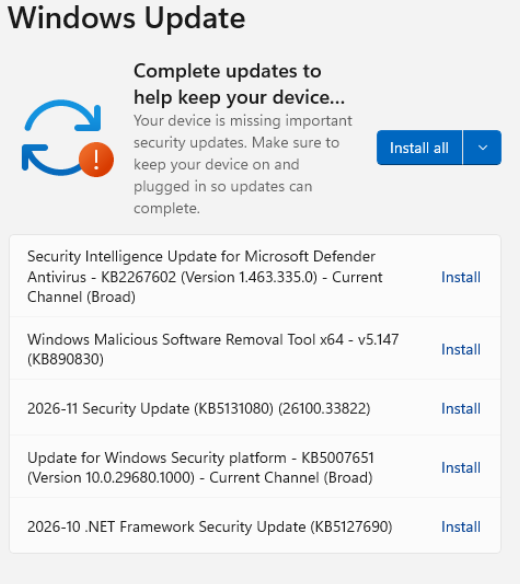

  The update sat at 74% for over an hour. I checked three things: the VM's processor and disk graphs in Proxmox (low but not zero), the Windows update worker process's processor time (240.27 to 240.77 seconds in about a minute), and the servicing log (`C:\Windows\Logs\CBS\CBS.log`), which had not been written to for about 26 minutes. I read all of that as stuck and rolled the VM back to its snapshot.

  The second try stalled at 74% again, even with `client01` and `glpi01` shut down to free up the slow drive. This time I left it overnight. By morning it had finished and restarted itself, and the build number was 26100.33822. So it was slow, not stuck, and the rollback wasn't needed. I can't say whether shutting the other VMs down helped. Lesson: a quiet log doesn't prove an update has stalled, and a patient wait is the only real test.

* **The console shows what it loaded at the last refresh.** I misread a stale screen as if client01 hadn't reported. Refresh the WSUS console before reading it.

### Observations I didn't follow up

* The Operating System column in WSUS shows client01 as "Windows 10 Enterprise", although it runs Windows 11. I haven't found out why.
* The Approval column for the approved update says `Install (1/3)`. I take it to mean approved for one of three groups, but I haven't checked.
* The Installed/Not Applicable column on the update list stayed empty at the start, because I had approved nothing yet. I believe WSUS only evaluates approved updates for a client, but I haven't confirmed that.
* Microsoft's notes for the November update say WSUS doesn't show synchronization error details after a recent change. My sync succeeded, so I didn't need them.

## Limitations and not tested

* One client, one package and one WSUS update. I did not test WSUS delivering a missing update (see above).
* Not tested: a real 03:00 install, a forced restart at a deadline, removing Firefox through Group Policy, or updating a deployed package.
* The update files are on the C: drive of `wsus01`, and the share is on the domain controller. Both are lab shortcuts.
* The VM storage is a slow laptop hard drive, which made the patching slow.
* WSUS is set to sync by hand, and there are no approval rules, no clean-up and no HTTPS. It's only reachable on my home network, and I did not open any ports to the internet.
* Computers are placed in `Lab-Clients` by hand. I didn't try a Group Policy to do it automatically.
* `wsus01` is an evaluation edition, which expires in roughly six months. I haven't checked the exact date.
* Not done: imaging (Part 4).

## Related projects

* [Windows Server and Active Directory](../windows-server-ad/)
* [File server](../file-server/)
* [Proxmox server](../server/)
