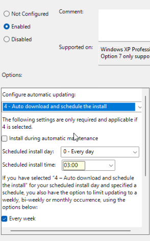
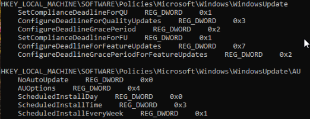
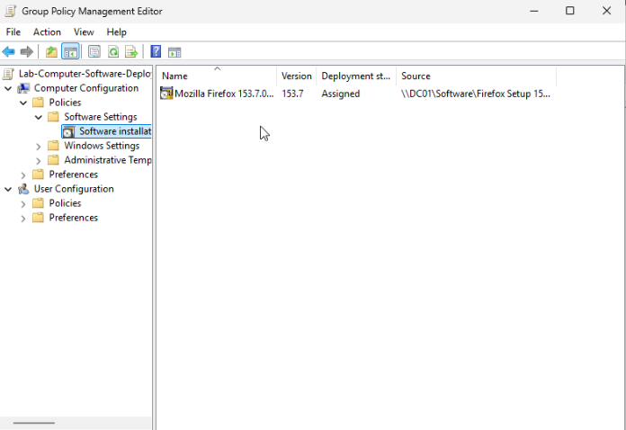
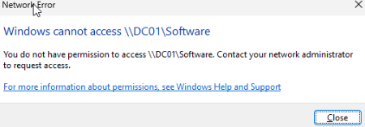
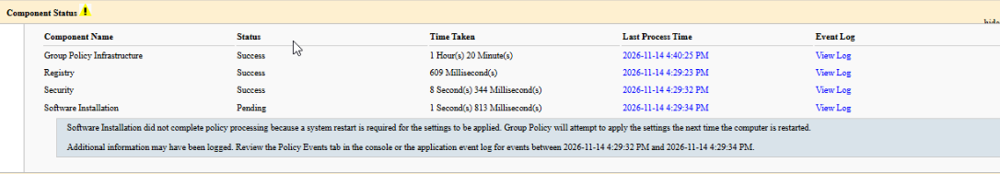

# Endpoint management on Windows Server (DC01)

**Status:** In progress. Parts 1 and 2 are built and tested. Part 3 (WSUS) and a replacement for imaging are planned. | **Built:** 2026-11-14 to 2026-11-15

## Goal

Manage a Windows 11 client from the domain controller: control how it takes Windows updates, and install software on it without touching it. Both are done with Group Policy and tested on a domain-joined client.

## Scope: what changed from my plan

My plan listed WSUS, WDS and MDT. Before building anything I checked their status in November 2026. The sources were news and documentation pages I found by search, not all from Microsoft, so treat the details as unverified:

* **WSUS** is deprecated but still works on Windows Server 2025.
* **MDT** was retired in January 2026, and its downloads were pulled.
* **WDS** still exists but is being phased out, and Windows 11 can't be deployed end to end with WDS alone.

So I split the project into parts:

| Part | What | Status |
| --- | --- | --- |
| 1 | Windows Update settings through Group Policy | Done |
| 2 | Software deployment through Group Policy | Done |
| 3 | WSUS | Planned (needs a new VM) |
| 4 | Imaging | To be decided. WDS and MDT are dropped. |

## Environment

* **DC01:** Windows Server 2025 Standard (evaluation) in a Proxmox VM, domain `homelab.internal`. See the [Proxmox server](../server/) page for the host, which now has 32GB of RAM.
* **client01:** Windows 11 Enterprise (evaluation, 26H2), joined to the domain and in the `Lab > Computers` OU.
* Both policies below are linked to `Lab > Computers`, next to my logon banner policy from the [Windows Server and Active Directory project](../windows-server-ad/).

## Part 1: Windows Update through Group Policy

### Design

One policy, `Lab-Computer-Windows-Update`, with three settings. I did not point the client at a WSUS server, because that is Part 3.

| Setting | Value |
| --- | --- |
| Configure Automatic Updates | Enabled, option 4 (auto download and schedule the install), every day at 03:00, "install during automatic maintenance" off |
| Deadline for quality updates | 3 days, 2-day grace period |
| Deadline for feature updates | 7 days, 2-day grace period |

I chose option 4 because Microsoft's guidance warns that the options that wait for the user can end in a forced restart at the deadline with no warning. The deadline values follow Microsoft training material (7 days for feature updates, 3 for quality, 2 for the grace period). The editor's own defaults were different: 7 and 2 for quality, and 2 and 7 for feature. I don't know why the feature defaults are reversed.



### What I did

1. Took a Proxmox snapshot of DC01 (`before_updatepolicy`).
2. Created the policy and linked it to `Lab > Computers`.
3. Found the settings under Computer Configuration > Administrative Templates > Windows Components > Windows Update > Manage end user experience, and set the three values.
4. Made a settings report to check every value on one page.
5. On client01, ran `gpupdate /force` and checked the result three ways.
6. Took a second snapshot (`after_updatepolicy`).


### Checking it worked

```powershell
gpupdate /force
gpresult /scope computer /r
reg query "HKLM\SOFTWARE\Policies\Microsoft\Windows\WindowsUpdate" /s
```

`gpresult` listed `Lab-Computer-Windows-Update` as applied. The registry on client01 held every value I set:

| Setting | Stored value |
| --- | --- |
| Quality deadline 3 days | `ConfigureDeadlineForQualityUpdates` = 0x3 |
| Quality grace period 2 days | `ConfigureDeadlineGracePeriod` = 0x2 |
| Feature deadline 7 days | `ConfigureDeadlineForFeatureUpdates` = 0x7 |
| Feature grace period 2 days | `ConfigureDeadlineGracePeriodForFeatureUpdates` = 0x2 |
| Option 4 | `AUOptions` = 0x4 |
| Every day | `ScheduledInstallDay` = 0x0 |
| 03:00 | `ScheduledInstallTime` = 0x3 |



Windows 11 also lists the policies itself, under Settings > Windows Update > Advanced options > Configured update policies. All eight entries appeared with `Type: Group Policy`.


### What went wrong and what I learned

* **The report tab in Group Policy Management was blocked.** Windows Server's Internet Explorer Enhanced Security Configuration blocked the Settings tab, which draws a web page. I didn't loosen the security setting. I made the same report as a file with `Get-GPOReport -Name "Lab-Computer-Windows-Update" -ReportType Html -Path "$env:TEMP\wu-report.html"` and opened it in a browser.
* **I ran the client checks on the wrong machine.** `gpupdate` and `gpresult` ran on DC01, and the list showed the Default Domain Controllers Policy, which only applies to domain controllers, and not my Lab policies. `hostname` confirmed it. Lesson: check `hostname` before running anything with two similar consoles open.
* **A one-word path typo.** My first `reg query` left out `Windows\` in the path and returned "unable to find the specified registry key". The same kind of slip as an earlier `Share` and `Shares` error in the file server project.
* **No "managed by your organization" banner.** The Settings page showed nothing, even after reopening it. A forum post said Windows 11 doesn't show that message, and the policy list under Advanced options is where it shows the policies. I haven't confirmed that with a Microsoft page.

## Part 2: Software deployment through Group Policy

### Design

Group Policy can install programs on a computer when it starts, if the installer is an MSI and sits on a network share the computer can read.

* **A new share:** `\\DC01\Software` (folder `C:\Shares\Software`). Domain Computers get read access, because the install runs under the computer's own account before anyone signs in. IT-Admins get full control, so I can copy installers in. Staff and Help-Desk have no access.
* **The test program:** Firefox ESR, 64-bit MSI, version 153.7.0, from Mozilla's enterprise download page. I first planned 7-Zip, but the newest release appeared to offer only an exe installer, with MSI files only for older versions, and I didn't want to deploy an old version on purpose.
* **A policy:** `Lab-Computer-Software-Deployment`, linked to `Lab > Computers`, with Firefox assigned under Computer Configuration > Software Settings > Software installation. I used the network path of the installer, not a local one.

| Level | Domain Computers | IT-Admins |
| --- | --- | --- |
| Folder permission (NTFS) | Read and Execute | Full control |
| Share permission | Read | Full access |

### What I did

1. Took snapshots before starting (`before_softwaredeploy` on client01, and `after_updatepolicy` on DC01 as the baseline).
2. Created the folder, set its permissions and shared it:

   ```powershell
   New-Item -Path C:\Shares\Software -ItemType Directory
   icacls C:\Shares\Software /grant "HOMELAB\Domain Computers:(OI)(CI)RX" "HOMELAB\IT-Admins:(OI)(CI)F"
   New-SmbShare -Name "Software" -Path "C:\Shares\Software" -ReadAccess "HOMELAB\Domain Computers" -FullAccess "HOMELAB\IT-Admins"
   ```

3. Downloaded the Firefox MSI on client01 and copied it into the share.
4. Created the policy, linked it to `Lab > Computers`, and added the package as **Assigned**.

   

5. On client01, ran `gpupdate /force`. Software installation can only be applied at startup, so Windows warned that a restart was needed and asked to restart.

   

6. Restarted. Firefox did not install (see below). I added the "Always wait for the network at computer startup and logon" setting to the same policy, ran `gpupdate /force`, and restarted again. Firefox then appeared.
7. Took snapshots of both VMs (`after_softwaredeploy`).

### Checking it worked

I made a Group Policy report on client01 with `gpresult /scope computer /h "$env:TEMP\sw-report.html" /f`. The Component Status table showed Software Installation as **Success**, and the report listed Mozilla Firefox 153.7.0esr as installed by `Lab-Computer-Software-Deployment` from the share. I read the installed version from the list Windows keeps in the registry:

```powershell
Get-ItemProperty "HKLM:\SOFTWARE\Microsoft\Windows\CurrentVersion\Uninstall\*","HKLM:\SOFTWARE\WOW6432Node\Microsoft\Windows\CurrentVersion\Uninstall\*" -ErrorAction SilentlyContinue | Where-Object { $_.DisplayName -like "*Firefox*" } | Select-Object DisplayName, DisplayVersion
```

It returned `Mozilla Firefox ESR (x64 en-US)`, version `153.7.0`, matching the package.


### What went wrong and what I learned

* **The Package dialog couldn't open the share.** I was signed in to DC01 as the built-in `Administrator`, which isn't in IT-Admins. The `Software` share only lists Domain Computers and IT-Admins, so it refused with "You do not have permission to access". I confirmed the account with `whoami`, signed in as `lab.admin` (an IT-Admins member) and the dialog opened. Lesson: share permissions apply to the account you use, even an administrator.

  

* **The first restart didn't install Firefox.** The Component Status table showed Software Installation as **Pending**, with a note that a restart was required. Client01 had started after the time shown in that row, so startup hadn't processed it. I added the wait-for-network setting and restarted again, and the install worked. I changed two things at once, the setting and a second restart, so I can't say which one fixed it.

  

* **No install record in the event log.** `Get-WinEvent` for the `Application Management` provider found no events, even after the install had worked. I don't know why. (My first attempt misspelled the provider name, which gave a different error.)

### Observations I didn't follow up

* The Component Status table showed a Software Installation time of 3 hours 29 minutes, and an earlier report showed 1 hour 20 minutes for another row. Processing doesn't take hours. I suspect a clock jump or time sync problem on the VM, but I haven't checked.

## Limitations and not tested

* One client and one package.
* I did not test removing Firefox through Group Policy. The setting "uninstall when out of scope" is off, and Mozilla's page says its MSI doesn't support uninstalling with `msiexec /x`.
* The file share is on the domain controller. That is a lab shortcut, as in the file server project.
* Not done: WSUS, imaging, and updating a deployed package.

## Related projects

* [Windows Server and Active Directory](../windows-server-ad/README.md)
* [File server](../file-server/README.md)
* [Proxmox server](../server/README.md)
