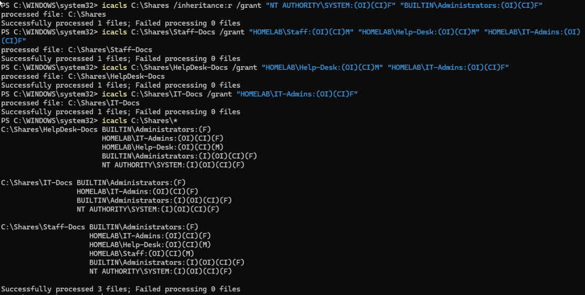
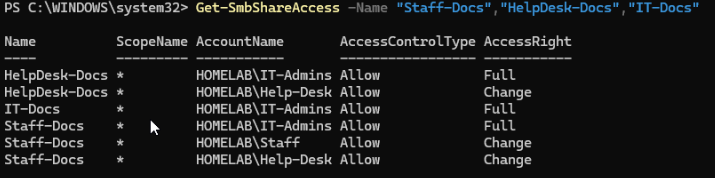
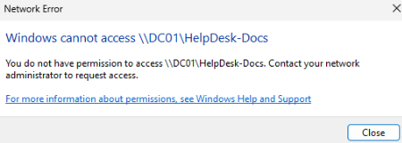
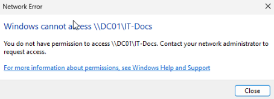

# File server on Windows Server (DC01)

**Status:** Complete (lab) | **Tested:** 2026-11-09

## Goal

Share folders from a Windows Server so that access is controlled by Active Directory groups. I used both layers of Windows access control (share permissions and NTFS permissions) and tested the result from a domain-joined client as three different roles: Staff, Help-Desk and IT-Admins.

## Lab shortcut (deliberate)

The file shares live on **DC01**, which is also the domain controller. I did this to save RAM until a memory upgrade arrives. In a real environment the shares would live on a separate member server, on a separate data drive, not on the domain controller's C: drive. Also, `IT-Admins` is a member of Domain Admins in this lab, so IT admins have broad rights anyway.

## Environment

- **DC01:** Windows Server 2025 Standard (evaluation) in a Proxmox VM, domain `homelab.internal`
- **client01:** Windows 11 Enterprise (evaluation), joined to the domain
- **Groups used:** `Staff`, `Help-Desk`, `IT-Admins` (created in the [Windows Server and Active Directory project](../windows-server-ad/))

## Design

| Folder | Staff | Help-Desk | IT-Admins |
| --- | --- | --- | --- |
| Staff-Docs | Modify | Modify | Full control |
| HelpDesk-Docs | No access | Modify | Full control |
| IT-Docs | No access | No access | Full control |

Design decisions:

- One parent folder, `C:\Shares`, with one subfolder per share.
- NTFS permissions first, shares second, so nothing is exposed while I'm still setting up.
- The parent folder is locked down so it only allows SYSTEM and Administrators. Each subfolder then gets only the groups that should have access.
- Share permissions use the same groups as the NTFS permissions. When the two layers differ, the stricter one wins, so keeping them in agreement makes the result predictable.

## What I did

1. Took a Proxmox snapshot of DC01 (`before_fileserver`).
2. Installed the File Server role. The role asked for a restart, which I did.

   ```powershell
   Install-WindowsFeature -Name FS-FileServer -IncludeManagementTools
   Restart-Computer
   Get-WindowsFeature -Name FS-FileServer
   ```

3. Created the folders.

   ```powershell
   New-Item -Path C:\Shares\Staff-Docs, C:\Shares\HelpDesk-Docs, C:\Shares\IT-Docs -ItemType Directory
   ```

4. Locked down the parent folder.

   ```powershell
   icacls C:\Shares /inheritance:r /grant "NT AUTHORITY\SYSTEM:(OI)(CI)F" "BUILTIN\Administrators:(OI)(CI)F"
   ```

5. Set NTFS permissions on each folder.

   ```powershell
   icacls C:\Shares\Staff-Docs /grant "HOMELAB\Staff:(OI)(CI)M" "HOMELAB\Help-Desk:(OI)(CI)M" "HOMELAB\IT-Admins:(OI)(CI)F"
   icacls C:\Shares\HelpDesk-Docs /grant "HOMELAB\Help-Desk:(OI)(CI)M" "HOMELAB\IT-Admins:(OI)(CI)F"
   icacls C:\Shares\IT-Docs /grant "HOMELAB\IT-Admins:(OI)(CI)F"
   ```

6. Checked the result with `icacls C:\Shares\*`.

   

7. Created the three shares.

   ```powershell
   New-SmbShare -Name "Staff-Docs" -Path "C:\Shares\Staff-Docs" -ChangeAccess "HOMELAB\Staff","HOMELAB\Help-Desk" -FullAccess "HOMELAB\IT-Admins"
   New-SmbShare -Name "HelpDesk-Docs" -Path "C:\Shares\HelpDesk-Docs" -ChangeAccess "HOMELAB\Help-Desk" -FullAccess "HOMELAB\IT-Admins"
   New-SmbShare -Name "IT-Docs" -Path "C:\Shares\IT-Docs" -FullAccess "HOMELAB\IT-Admins"
   ```

8. Checked the share permissions with `Get-SmbShareAccess`.

   ```powershell
   Get-SmbShareAccess -Name "Staff-Docs","HelpDesk-Docs","IT-Docs"
   ```

   

9. Took a second snapshot (`after_fileserver`).

## Testing

I tested from client01, signing in as a Staff user, a Help-Desk user and the IT admin account.

| User | Staff-Docs | HelpDesk-Docs | IT-Docs |
| --- | --- | --- | --- |
| Staff | Opened, created a file | Refused | Refused |
| Help-Desk | Opened, created a file | Opened, created a file | Refused |
| IT admin | Opened | Opened | Opened, created a file |

The refusals for the Staff user showed "You do not have permission to access...":




The IT admin account could also see the files created by the other two users in `Staff-Docs` and `HelpDesk-Docs`. The Help-Desk user could see the file the Staff user made in `Staff-Docs`.

## What went wrong and what I learned

- **The role needed a restart.** I expected it not to, and I hadn't confirmed this either way for Windows Server 2025. I checked that the install reported success before restarting.
- **A typo in a path.** I typed `C:\Share\...` instead of `C:\Shares\...` and got "The system cannot find the path specified." `Test-Path` showed the folder existed, and reading the failed command back showed the missing letter. Lesson: check the path first, and confirm a folder with `Test-Path` before assuming something deeper is wrong.
- **"Windows cannot access" is a generic headline.** It appears for name errors, network errors and permission errors alike. The sentence underneath is what tells them apart, so I checked for "You do not have permission" and for the correct server name before counting a refusal as a pass.
- **An unexpected extra permission entry.** Each of the three folders also showed `BUILTIN\Administrators:(F)` as an explicit entry for that folder only. It's harmless, since Administrators already have full control, but I don't know why it's there. My guess is it's a side effect of how Windows assigns ownership when an admin creates a folder, but I haven't confirmed that.
- **A slow first command after a restart.** `Get-WindowsFeature` sat on "collecting data" at 20% for a couple of minutes right after the restart, then finished with the expected result. I didn't confirm the cause.

## Limitations and not tested

- I did not test editing or deleting files that another user created, or two layers conflicting on purpose (for example, a user with Full share access but no NTFS access).
- The Help-Desk refusal on `IT-Docs` was observed but not screenshotted.
- Not configured: access-based enumeration, quotas or screening (File Server Resource Manager), DFS, drive mapping through Group Policy, and backups. Snapshots are on the same drive, so they are not backups.

## Related projects

- [Windows Server and Active Directory](../windows-server-ad/README.md)
- [Proxmox server](../server/README.md)
