# Help Desk: GLPI 12 on Ubuntu Server

A help desk built on a Linux VM running GLPI, an open-source IT service management tool. It runs on my [Proxmox server](../server/README.md). I used it to track my own build problems as tickets, keep an inventory of the lab, write runbooks, and test a service level agreement. Documented November 2026.

## Overview

| | |
|---|---|
| **VM** | glpi01 (VM 102): Ubuntu Server 24.04.5 LTS, 2 cores (host CPU), 2GB RAM, 32GB thin-provisioned disk on the 1TB drive |
| **Stack** | Apache 2.4.58, PHP 8.3.6, MariaDB 10.11.14, GLPI 12.0.1 |
| **Address** | `192.168.1.60/24` (fixed, set with netplan) |
| **Access** | HTTP on my home network only. There is no HTTPS certificate. |

I chose Ubuntu 24.04 over the newer 26.04 because the install guides I found were tested on 24.04, and I couldn't confirm that GLPI supports the PHP version 26.04 ships. I installed GLPI 12.0.1 because it was the latest release, and the VM met its minimums exactly (PHP 8.3 and MariaDB 10.11).

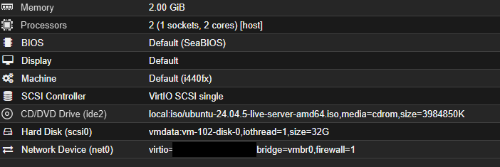

## What I built

1. **The VM and its network.** A fixed address, validated with `netplan generate` and applied with `netplan try`, which reverts after 120 seconds unless confirmed.
2. **The stack.** Apache, PHP, and MariaDB. I created a database and a dedicated database user limited to it, and loaded timezone data.
3. **GLPI.** Downloaded and unpacked GLPI 12.0.1, pointed Apache at its `public` folder, and ran the browser installer.
4. **Hardening.** Changed the default password on all four default accounts, removed the installer script, scheduled the background jobs, set the timezone, and turned on a firewall.
5. **The help desk itself.** A short tree of ticket categories, six tickets for my real build problems, seven assets, two knowledge base articles, and an SLA.

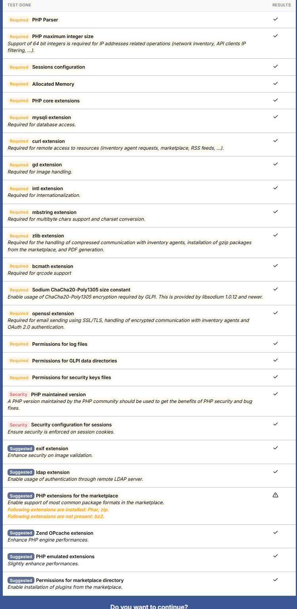
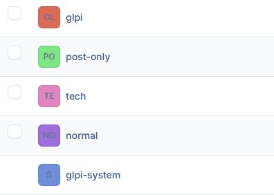

## Help desk configuration

- **Categories:** Hardware (with Storage), Network (with DNS and addressing), Operating system and software, Identity and access, and Other.
- **Tickets:** I entered six build problems retrospectively and said so in each description. Five were solved, approved, and closed. The SSD wear problem stays open on purpose, because it isn't resolved. I approved my own tickets, which a real help desk wouldn't do.
- **Assets:** the Proxmox host, three VMs, the admin PC, and both Raspberry Pis.
- **Knowledge base:** two internal runbooks, one for a failed domain join and one for resetting a password in Active Directory. They are visible only to the users I targeted, and neither is in the public FAQ.
- **SLA:** four hours to take ownership and three days to resolve, with no calendar, so the clock runs 24/7. The numbers are examples, not a contract.

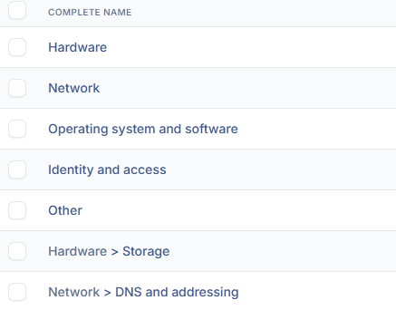
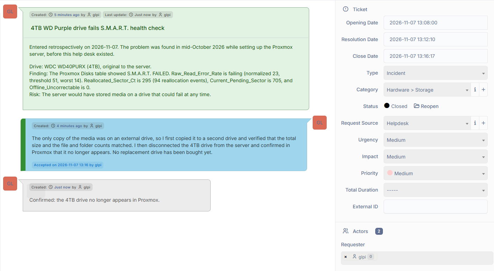
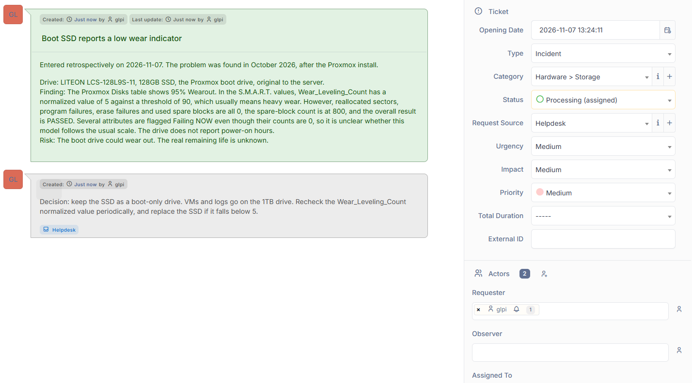
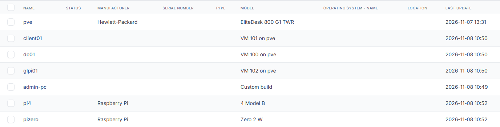

## How I verified it

| Check | Result |
|---|---|
| GLPI's pre-install check | All required and security items passed. One optional warning (a missing PHP extension) was fixed by installing it. |
| Installer script removed | A request to its web address returns 404 |
| Background jobs | The system log shows `front/cron.php` starting every minute as the web server's user |
| Automatic actions | CLI-mode actions show recent runs. I changed the SLA and notification-queue actions to CLI mode and confirmed they updated. |
| Default passwords | The old passwords for the three other default accounts are rejected |
| Knowledge base permissions | The targeted Technician sees both articles, an untargeted account sees none, and the self-service account has no access |
| Workflow | The ticket history shows New, then Processing (assigned), then Solved, then Closed, with actions by the requester and the technician |
| SLA | The due dates came out at the opening time plus four hours (to own) and plus three days (to resolve) |

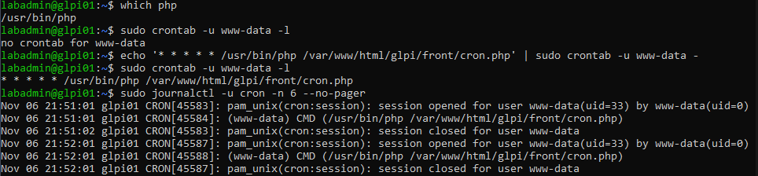
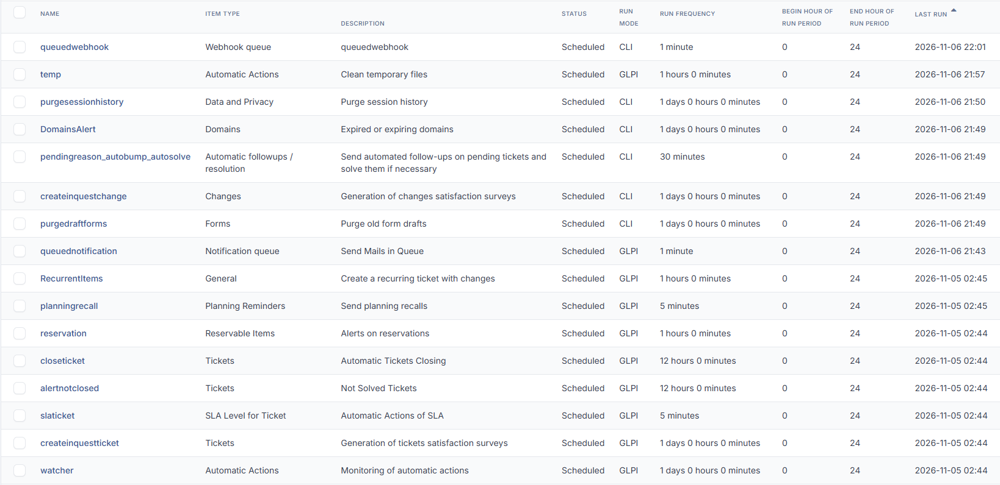
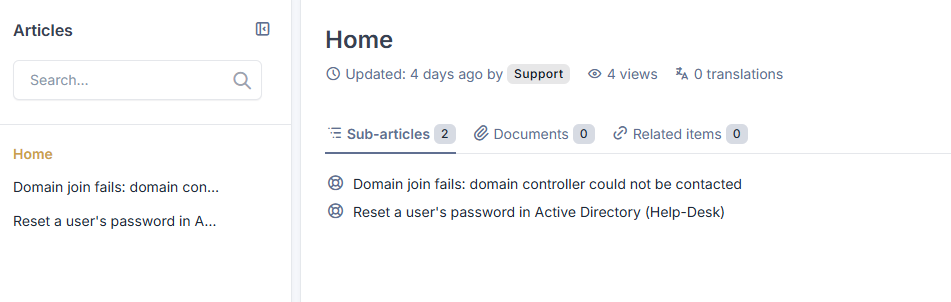
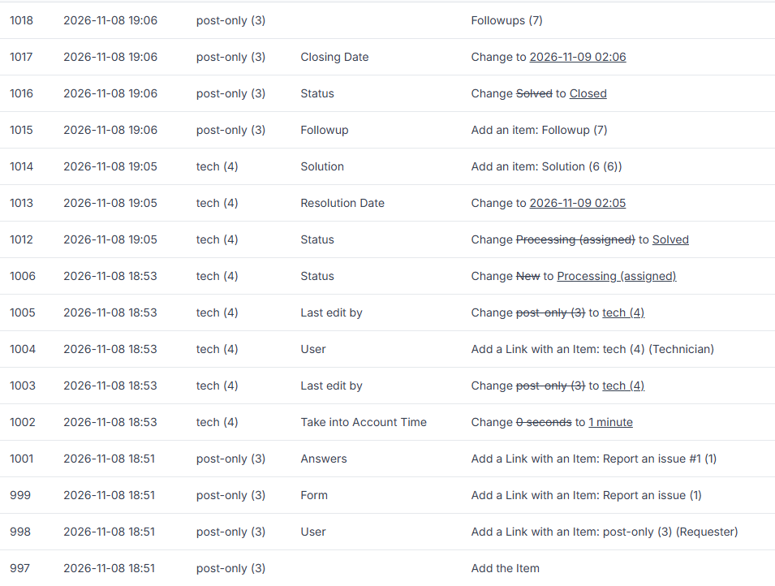

**Firewall** (`sudo ufw status verbose`):

```
Status: active
Default: deny (incoming), allow (outgoing), disabled (routed)
22/tcp (OpenSSH)   ALLOW IN   Anywhere
80/tcp             ALLOW IN   Anywhere
```

(The same two rules also appear for IPv6.)

**Listening ports** (`sudo ss -tlnp`): the database listens on `127.0.0.1:3306`, so only the VM itself can reach it.

## Problems and fixes

**1. The SLA didn't save.** I assigned the service levels to a test ticket, and the fields were blank when I opened it again. The ticket's history had no SLA lines, and every change in it came from the requester and technician accounts, none from the administrator who set the SLA. The service level pop-up needs a Save on the ticket form afterward. On a new ticket I saved, and the due dates came out right.

**2. Times looked wrong.** Some background actions showed runs from an evening I hadn't been signed in, and I wondered if someone else had logged in. The VM's clock was on UTC, and my PC is on Pacific time. I set the timezone on the VM and in GLPI, and the times lined up with my PC's clock. I didn't resolve one oddity. A ticket's history showed a gap of seven hours between a stored closing time and the entry time, where I'd have expected eight.

**3. Default accounts.** The installer lists four accounts with published passwords. GLPI 12 showed no warning about it, so I changed them myself and tested that the old ones fail.

**4. Knowledge base articles were hidden.** New articles are visible only to their author until a target is set from the article's menu.

**5. The guide was for an older GLPI.** The tutorial I followed covered GLPI 11, and the latest release was 12. I checked the version's requirements before installing it.

**6. The firewall was left out at first.** The tutorial turns one on, and I left that step out when I adapted it. I noticed after the install, enabled it, and checked it from a second SSH session before closing the first.

## Limits

- Traffic is HTTP, so logins aren't encrypted on my network. There is no certificate.
- The default administrator account is still named `glpi`, though its password is changed. In production I would create a named administrator and disable it.
- No email is set up, so notifications can't be sent.
- I tested the due dates, not a missed deadline, the pending status that pauses the clock, or escalation levels.
- The SLA is assigned by hand. A real help desk would use a rule.
- Snapshots are on the same drive as the VM, so they aren't a backup. A proper database backup belongs to my database projects.
- I haven't identified `glpi-system`, an internal account that GLPI created.
- I declined GLPI's optional usage statistics.

## Related projects

- [Proxmox homelab server](../server/README.md)
- [Windows Server Active Directory lab](../windows-server-ad/README.md)

*Passwords, serial numbers, hardware addresses, and internet addresses tied to my home connection are not shown. IP addresses are private (home network) addresses.*
