# Pi-hole + Unbound on a Raspberry Pi Zero 2 W

A network-wide DNS ad blocker (Pi-hole) that looks up website addresses itself (Unbound) instead of asking a public DNS provider, running on a Raspberry Pi Zero 2 W.

**Status:** Part 1 (2026-11-20): working and tested on one device, my Android phone. Part 2 (2026-11-24): switched on for the whole network through the modem's DHCP setting, with the lab's names (`homelab.internal`) passed to DC01. I saw my PC (VPN off), my phone and a games console using it, and probably a streaming stick. Known limits: the VPN on my PC overrides it, the Pi is now the household's only DNS server, IPv6 is unresolved, and the lab is not behind it. See [Part 2 limits](#limits-and-what-i-did-not-test-part-2).

**Built:** Part 1 on 2026-11-20, Part 2 from 2026-11-23 to 2026-11-24

## Goal

Run my own DNS server on a small, low-power board. Pi-hole answers the questions devices ask ("what is the address of this website?") and blocks known ad and tracking domains. Unbound sits behind it and finds answers by asking the internet's root servers directly, so no outside DNS provider sees every lookup.

## Hardware and software

| Item | Detail |
| --- | --- |
| Board | Raspberry Pi Zero 2 W (512 MB RAM, Wi-Fi only) |
| Name | `BananaCream` |
| Address | `192.168.1.189` (reserved on the modem) |
| OS | Raspberry Pi OS, Debian 13 "trixie", 32-bit (`armv7l`) |
| DNS blocker | Pi-hole |
| Resolver | Unbound 1.26.2 (Debian package) |
| Memory the OS sees | 424 MiB of the board's 512 MB |

## How it fits together

```
Phone (192.168.1.211)
   |  DNS question, port 53
   v
Pi-hole on BananaCream (192.168.1.189)
   |  blocked names get the answer 0.0.0.0
   |  allowed names are passed on, port 5335
   v
Unbound (127.0.0.1, same Pi)
   |  looks the answer up itself, starting from the root servers
   v
The internet's DNS servers
```

The home modem (`192.168.1.254`) still hands out addresses and DNS settings to every other device. Only the test phone uses the Pi-hole.

## What I did

### 1. Checked the Pi Zero 2 W was a reasonable fit

Pi-hole's official prerequisites list 512 MB of RAM as the minimum, which is exactly what this board has, so there is no spare room. The OS reports 424 MiB because part of the memory is reserved for the hardware. I decided to try it and measure memory after install. Raspberry Pi OS is on Pi-hole's supported list. The docs say "actively maintained versions" and do not name Debian 13, so I treated that as unconfirmed. The installer ran without refusing.

I also considered DietPi (a lighter OS). I stayed with Raspberry Pi OS because it is on the official supported list, the official install steps are written for it, and I had no evidence that memory would be a problem.

### 2. Gave the Pi a fixed address

Pi-hole needs a fixed address. I added a reservation (static lease) for the Pi's Wi-Fi in the modem under Local Network > LAN > Static Leases, using the address it already had.

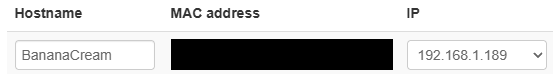

The modem said the address was "already in use" and asked for a reboot. I restarted only the Pi. It came back on the same address.

### 3. Connected over SSH

I connected from my Windows PC with Command Prompt. PowerShell tried to open SSH in a separate app, so I used Command Prompt instead.

### 4. Installed Pi-hole

I downloaded the official installer (`wget -O basic-install.sh https://install.pi-hole.net`) and ran it with `sudo bash basic-install.sh`, instead of piping it straight into a shell, so the script was saved and could be looked at before it ran.

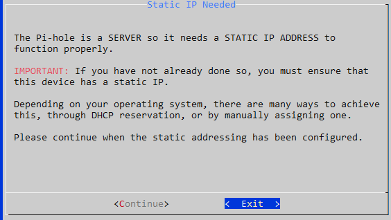

Choices during the install:

- **Upstream DNS:** Cloudflare (DNSSEC), as a temporary choice. Unbound did not exist yet, and pointing Pi-hole at a service that wasn't running would likely have stopped DNS working. I replaced it with Unbound in step 9.
- **Blocklist:** the default StevenBlack list (76,105 domains loaded).
- **Query logging:** on, so I could see who asked what and prove Unbound was being used.
- **Privacy level:** show everything. Pi-hole's docs say details hidden at a higher level cannot be recovered later by lowering the level, and I wanted the full log for testing.


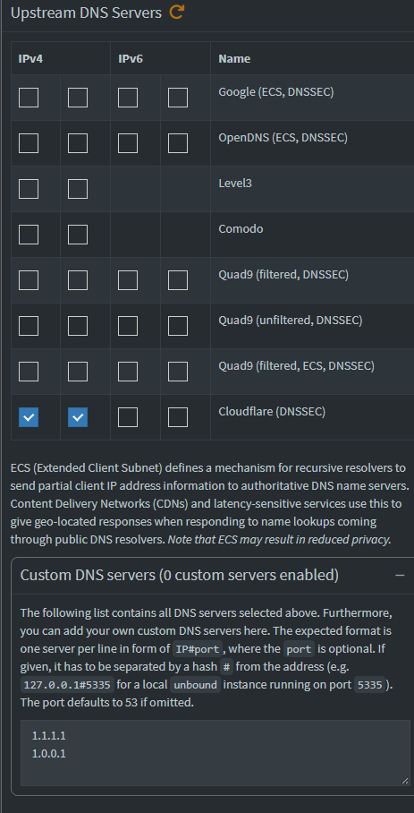

### 5. Installed Unbound and hit a port clash

`sudo apt install unbound` installed the package but Unbound would not start. The log said:

```
error: can't bind socket: Address already in use for ::1 port 53
fatal error: could not open ports
```

Pi-hole was already using port 53, which is also Unbound's default.

### 6. Tested that my connection reaches the root servers

Pi-hole's Unbound guide recommends three tests before continuing, because some internet providers quietly redirect DNS traffic. All three passed (results in the table below).

### 7. Configured Unbound

I wrote `/etc/unbound/unbound.conf.d/pi-hole.conf` from the official Pi-hole guide (shortened two long comment blocks, no setting changes). The settings that fix the clash are:

```
interface: 127.0.0.1
port: 5335
```

`unbound-checkconf` reported no errors.

### 8. Switched off the resolvconf helper

The guide says the `unbound-resolvconf.service` helper can overwrite `/etc/resolv.conf` and cause odd behaviour. I ran `sudo systemctl disable --now unbound-resolvconf.service`. The guide's other two commands had nothing to act on: `/etc/resolvconf.conf` does not exist on this Pi, and there was no `resolvconf_resolvers.conf` file. I do not know exactly why the first is missing.

After that, `sudo service unbound restart` brought Unbound up on port 5335.

### 9. Pointed Pi-hole at Unbound

In Pi-hole's web page, Settings > DNS: unticked Cloudflare and entered `127.0.0.1#5335` as the only custom DNS server.


### 10. Tested from my PC and found the VPN in the way

From my Windows PC, `nslookup en.wikipedia.org 192.168.1.189` timed out with my VPN on and worked with it off. Asking the Pi from the Pi itself on its network address also worked. The VPN is the likely cause, but I did not look inside the VPN's settings to confirm.

### 11. Tested with a real device (my phone)

I did not change the modem's DNS setting. Instead I set the phone's own Wi-Fi settings to a static IP with both DNS boxes on the Pi-hole (`192.168.1.189`). The phone's IP, gateway and prefix length kept the values it already had. Setting both DNS boxes to the same address means the phone cannot quietly fall back to the modem and skip Pi-hole.

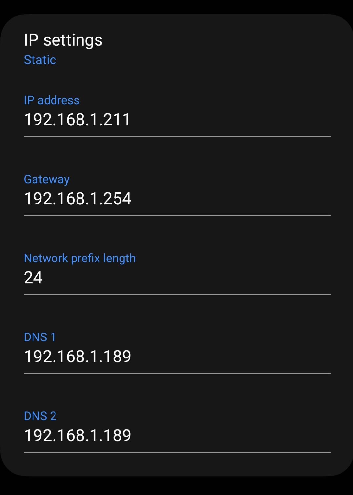

The phone's questions showed up in the Query Log, and the log showed them being forwarded to Unbound.


### 12. Tested blocking

`dig doubleclick.net @192.168.1.189` (run from the Pi) returned `0.0.0.0`, and the Query Log shows it blocked. This test came from the Pi, not the phone.

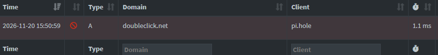
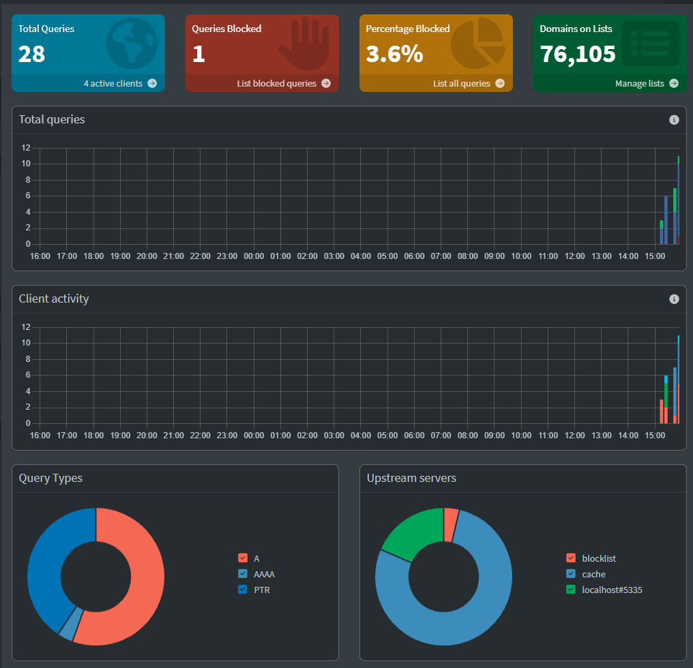

### 13. Tested a restart

After `sudo reboot`, both services were `active` without me starting anything, an Unbound lookup worked, and the phone loaded a page (slightly slower on first load, nothing I'd call noticeable, which is a casual impression, not a measurement).

## How I checked it

| Check | Command | Good result | What I got |
| --- | --- | --- | --- |
| Root server reachable (UDP) | `dig @198.41.0.4 . NS +norec +time=3` | `aa` flag, no `ra` | `flags: qr aa`, 13 answers |
| Root server reachable (TCP) | `dig @198.41.0.4 . NS +norec +tcp +time=3` | `aa` flag, no `ra` | `flags: qr aa`, 13 answers |
| Real root server | `dig @198.41.0.4 version.bind CH TXT +time=3` | `"ATLAS"` | `"ATLAS"` |
| Unbound answers | `dig pi-hole.net @127.0.0.1 -p 5335` | `NOERROR` and an address | `NOERROR` and an address |
| DNSSEC rejects a broken record | `dig fail01.dnssec.works @127.0.0.1 -p 5335` | `SERVFAIL` | `SERVFAIL` |
| DNSSEC accepts a good record | `dig +ad dnssec.works @127.0.0.1 -p 5335` | `NOERROR` and the `ad` flag | `NOERROR`, `flags: qr rd ra ad` |
| Pi-hole hands questions to Unbound | `sudo grep "forwarded www.google.com" /var/log/pihole/pihole.log` | forwarded to `127.0.0.1#5335` | forwarded to `127.0.0.1#5335` |
| Ad domain blocked | `dig doubleclick.net @192.168.1.189` | `0.0.0.0` | `NOERROR`, `0.0.0.0` |
| Services after a restart | `systemctl is-active unbound pihole-FTL` | `active` twice | `active`, `active` |

## Memory

Measured with `free -h` while the Pi was mostly idle:

| Point | `available` memory |
| --- | --- |
| Before Pi-hole | 311 MiB |
| After Pi-hole | 302 MiB |
| Pi-hole and Unbound running | 289 MiB (swap used: 152 KiB) |

These shift from moment to moment, and Unbound's memory use grows as it stores answers.

## What went wrong

1. **Unbound would not start.** Port clash with Pi-hole on port 53. Fixed by moving Unbound to `127.0.0.1` port 5335.
2. **DNS timed out from my PC.** My VPN was the likely cause. It worked with the VPN off.
3. **Two steps in the guide did not apply** because the files they edit are not on this system (see step 8).

## Limits and what I did not test

- **Only one device uses it.** The modem still tells every other device to use the modem for DNS. I have not made the network-wide change.
- **The address reservation is unproven.** The Pi kept its address after one restart, which modems often allow anyway. I did not test the reservation by forcing a clash.
- **IPv6 may bypass Pi-hole.** My modem has its own IPv6 DNS, and on an earlier lab machine that was asked first. I did not test this here.
- **Wi-Fi stability over days is unknown.** The Pi has no network port. A USB-to-Ethernet adapter is the fallback.
- **Memory was measured while idle,** and I will recheck after a few days of real use.
- **Restart speed is a single reading.** The first Unbound lookup after the restart took 320 ms. I have no earlier timing to compare it with.
- **Blocking was tested with one domain** (`doubleclick.net`).
- **The phone is on a static IP.** If the modem gave its address to another device there would be a clash. I will switch it back to automatic (DHCP) when testing ends.
- **The Pi has no backup.** If the memory card fails I would rebuild from these steps.
- **Debian 13 support is not confirmed in the official docs.** It installed and ran.

## Part 2: Using it for the whole network

**Built:** 2026-11-23 to 2026-11-24

Part 1 above describes the state on 2026-11-20, when only my phone used the Pi-hole. This part switches it on for the rest of the network and checks that the lab's own names (`homelab.internal`) still work.

### Goal

Make every device that takes its settings from the modem use the Pi-hole, without breaking the lab's names. Each step is proved from both sides: what the device says it asked, and what Pi-hole's Query Log says it received.

### How it fits together now

```
Device on the home network (phone, PC, consoles...)
   |  asks the modem for its settings (DHCP)
   |  the modem now answers: "DNS server = 192.168.1.189"
   v
Pi-hole on BananaCream (192.168.1.189)
   |-- names ending in homelab.internal --> DC01 (192.168.1.50), which knows the lab's names
   |-- blocked names get the answer 0.0.0.0
   |-- everything else --> Unbound (127.0.0.1, port 5335) --> the internet's DNS servers
```

The lab itself is not behind the Pi-hole. `client01` asks DC01 for DNS, and DC01 passes unknown names to the modem. I left that alone on purpose (step 20).

## What I did (Part 2)

### 14. Checked the Pi was healthy

`systemctl is-active pihole-FTL unbound wg-quick@wg0` printed `active` three times (Pi-hole, Unbound, WireGuard).

### 15. Wrote down the modem's original setting

The modem's DNS server box (Local Network > LAN > DHCP settings, advanced view) held `192.168.1.254`, the modem itself, and DHCP Server was on. That is the undo: put `192.168.1.254` back in the box and save. The modem's lease time turned out to be 24 hours (step 21).

### 16. Checked whether devices could skip Pi-hole

- **Android Private DNS** on my phone was on Automatic. I only read the setting.
- **IPv6, the Pi's view:** `nmcli device show wlan0 | grep DNS` showed one IPv4 DNS line (`192.168.1.254`) and no IPv6 DNS line. I first took that as a good sign. It was misleading.
- **IPv6, the modem's announcement:** I installed `ndisc6` and ran `sudo rdisc6 wlan0`, which prints the modem's router announcement. It contains a `Recursive DNS server` line (the modem's own IPv6 address, left out here), a DNS search list of `lan`, and "Stateful other conf: Yes". So the modem does announce itself as an IPv6 DNS server, even though the Pi did not list it. I do not know why.
- **Does that server work, and does it block?** `dig +short @<modem's IPv6 address> doubleclick.net` returned a normal address, not `0.0.0.0`. A device using it would get answers but no blocking.
- **My PC** had no IPv6 address on Wi-Fi, so this route could not apply to it.

I did not find out which devices actually use the modem's IPv6 DNS.

### 17. Tested one more device first: my PC

With the PC's VPN off, I set its Wi-Fi DNS by hand to `192.168.1.189`. Then:

- `nslookup example.com` showed `Server: pi.hole`, `Address: 192.168.1.189`, and Pi-hole's Query Log had a row for it.
- `nslookup doubleclick.net` returned `0.0.0.0` (and `::`), so blocking works for the PC.

With the VPN turned back on, the same lookup showed `Server: UnKnown`, `Address: 103.86.96.100`, which is the VPN company's DNS server. The VPN overrides Pi-hole.

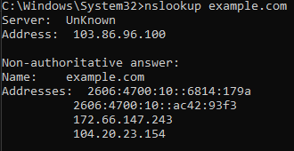

I then set the PC's DNS back to automatic (DHCP).

### 18. Found the gap in the lab's names

DC01's DNS forwarder is the modem (`Get-DnsServerForwarder` showed `192.168.1.254`). Pi-hole knew nothing about the lab: `nslookup wsus01.homelab.internal 192.168.1.189`, run on DC01, answered `Non-existent domain`. Asking DC01 itself (`... 192.168.1.50`) returned `192.168.1.55` (plus an IPv6 address). So the lab's names live only on DC01, and a device that asked Pi-hole for them would fail.

A first run of this test used `wsus` instead of `wsus01`. A name that doesn't exist gets the same error from any DNS server, so that run proved nothing. I repeated it with the exact name.

### 19. Added a rule that sends the lab's names to DC01

Pi-hole calls this setting "Rev server" (formerly "conditional forwarding"). Versions: Core v6.6, Web v6.6.1, FTL v6.9. Before changing anything I copied the settings file (`sudo cp -p /etc/pihole/pihole.toml /root/pihole.toml.bak-2026-11-23`). I then set the rule from the command line. Pi-hole's docs say the web interface, API and CLI check entries for errors, and a forum post reported the web form failing to save this setting on an older version.

```
sudo pihole-FTL --config dns.revServers '[ "true,192.168.1.0/24,192.168.1.50,homelab.internal" ]'
```

The four parts are `true` (on), `192.168.1.0/24` (the home network range, used for reverse lookups), `192.168.1.50` (DC01) and `homelab.internal` (the domain). Before the change the setting printed `[]`, and afterwards it printed the new rule. The undo is `sudo pihole-FTL --config dns.revServers '[]'`.


### 20. Tested the rule, and left the lab alone

Asked through the Pi from DC01:

- `wsus01.homelab.internal` now returned `192.168.1.55`.
- `example.com` still resolved.
- `nslookup -type=SRV _ldap._tcp.dc._msdcs.homelab.internal` returned `dc01.homelab.internal` on port 389 with address `192.168.1.50`, so the lab's login directions still come through the Pi.

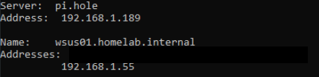
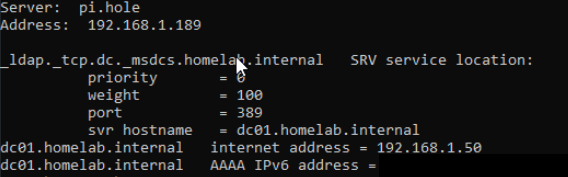

`client01` uses DC01 (`192.168.1.50`) as its DNS server (`Get-DnsClientServerAddress -AddressFamily IPv4`), so the lab does not use the Pi-hole. I decided not to point DC01's forwarder at the Pi. The lab would then depend on the Pi, and the rule above sends reverse lookups for `192.168.1.0/24` to DC01, so I worry about a loop. That worry is untested. I just did not want to risk the network.

### 21. Changed the modem

Before the change I set my phone back from its static test settings to automatic (DHCP) and loaded `example.net` on it. It did not appear in Pi-hole's Query Log. That was the "before" picture: the phone no longer used the Pi-hole.

I then replaced `192.168.1.254` in the modem's DNS server box with `192.168.1.189`. The modem said "Changes saved successfully", and after reloading the page the box showed `192.168.1.189`. The lease time is 24 hours, so devices pick up the new setting when they renew or reconnect.

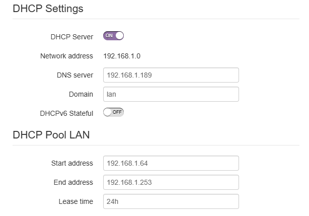

### 22. Tested after the change

**PC:** I turned its Wi-Fi off and on so it asked the modem again. `netsh interface ip show dnsservers name="Wi-Fi 2"` then showed `DNS servers configured through DHCP: 192.168.1.189`. The Pi's address came from the modem, and I did not type it in. With the VPN off, `nslookup pitest6203.example.com` (a made-up name) answered from `pi.hole`, and Pi-hole's Query Log had a row for it. The output stopped after the `Name:` line without the error I expected, and I do not know why.

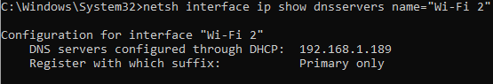

**Phone:** this took longer. After the first Wi-Fi off and on, pages loaded, but Pi-hole's Query Log showed only `www.google.com` from the phone, about once a minute. Reloading the log without browsing showed those lookups are the phone's own. Nothing appeared for the sites I loaded in Brave (twice) and Samsung Internet (once), including made-up names. Brave's "Use secure DNS" was on "Use your current service provider" and the Wi-Fi's proxy was None, so neither explained it. After one more Wi-Fi reset, `example.net` appeared, and `http://pitest4417.example.com` (a made-up name) showed up as A, AAAA and HTTPS lookups from the phone. I do not know why the first attempt did not work. While the phone was set by hand in Part 1, I recall a what's-my-IP page lookup did show up, so the hand-set mode worked for page lookups.

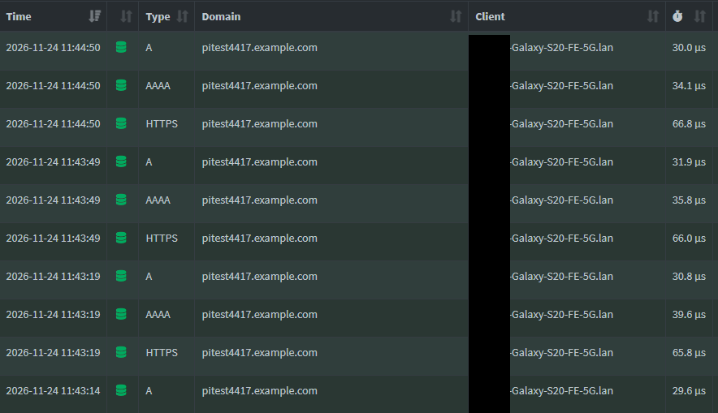

**Other devices:** Pi-hole's device list showed devices I never touched, which means they picked up the setting from the modem. One was a Sony games console, identified by the maker shown for its hardware address and by the time it was switched on. The person using it said it worked normally. Another, probably a Fire TV stick, appeared with an Amazon maker label and a lookup for a Fire TV domain. Both identifications are working guesses, not confirmed.

## How I checked it (Part 2)

| Check | Command | Good result | What I got |
| --- | --- | --- | --- |
| Services running | `systemctl is-active pihole-FTL unbound wg-quick@wg0` | `active` three times | `active` three times |
| Modem announces an IPv6 DNS server? | `sudo rdisc6 wlan0` | a `Recursive DNS server` line means yes | line present |
| PC uses Pi-hole (VPN off) | `nslookup example.com` | `Server: pi.hole` | `pi.hole`, `192.168.1.189` |
| Blocking works for the PC | `nslookup doubleclick.net` | `0.0.0.0` | `::` and `0.0.0.0` |
| VPN overrides Pi-hole | `nslookup example.com` (VPN on) | `pi.hole` if not overridden | `UnKnown`, `103.86.96.100` |
| Pi-hole did not know the lab name | `nslookup wsus01.homelab.internal 192.168.1.189` (on DC01) | (a gap, as expected) | `Non-existent domain` |
| DC01 does know it | `nslookup wsus01.homelab.internal 192.168.1.50` | an address | `192.168.1.55` |
| Rule stored | `sudo pihole-FTL --config dns.revServers` | the rule | `[ true,192.168.1.0/24,192.168.1.50,homelab.internal ]` |
| Lab name through the Pi after the rule | same lookup, asking `192.168.1.189` | `192.168.1.55` | `192.168.1.55` |
| Lab login directions through the Pi | `nslookup -type=SRV _ldap._tcp.dc._msdcs.homelab.internal 192.168.1.189` | `dc01.homelab.internal`, port 389 | priority 0, weight 100, port 389, `dc01.homelab.internal`, `192.168.1.50` |
| PC got the Pi from the modem | `netsh interface ip show dnsservers name="Wi-Fi 2"` | `192.168.1.189` via DHCP | `192.168.1.189` via DHCP |
| Phone's page lookups reach Pi-hole | load a made-up name in the phone's browser, search the Query Log | a row | rows for `pitest4417.example.com` |

## What went wrong (Part 2)

1. **A misleading IPv6 check.** The Pi's own view showed no IPv6 DNS, so I first thought the modem did not offer one. Reading the modem's router announcement directly (`rdisc6`) showed it does.
2. **A test with the wrong name.** A lab-name lookup used `wsus` and not `wsus01`, so its "not found" proved nothing (step 18).
3. **Misreading the phone's log.** I first treated the once-a-minute `www.google.com` rows as my own test lookups. Reloading the log without browsing showed they are the phone's own. My Part 1 phone check (step 11) also only showed that the phone's address was in the log. I never checked which websites those rows were for, so it was weaker than I thought.
4. **The phone's page lookups did not reach Pi-hole at first.** They did after a second Wi-Fi reset. The cause is unknown.

## Limits and what I did not test (Part 2)

**What changed from the Part 1 limits:** "only one device uses it" and "the phone is on a static IP" are no longer true. The phone is back on DHCP and other devices use the Pi-hole. The IPv6 limit is still open (below).

- **The VPN on my PC overrides Pi-hole.** Confirmed, and not fixed.
- **The Pi is now the household's only DNS server.** If it is off or loses Wi-Fi, devices that use it lose lookups until the modem's DNS box is changed back, which can only be done from home. I did not switch the Pi off to test this. Its Wi-Fi signal read 100 in one snapshot, which says nothing about days. A USB-to-Ethernet adapter or moving Pi-hole to a wired Pi are ideas I have not tried.
- **Not every device has switched yet.** The lease is 24 hours, so devices that are off or asleep switch when they renew or reconnect.
- **IPv6 is still open.** The modem still announces itself as an IPv6 DNS server, and I do not know which devices use it. I considered switching IPv6 off on the modem and decided not to without evidence.
- **The phone's delay is unexplained** (step 22).
- **The lab is not covered,** and the loop worry in step 20 is untested.
- **The rule's `/24` range also sends reverse lookups for home devices to DC01.** I did not test what DC01 does with them.
- **The device identifications are guesses** (games console, streaming stick).
- **Blocking was tested with one domain, on the PC only.**
- **The settings backup sits on the same memory card.** It is an undo copy, not a real backup.
- **The `ndisc6` tool is still installed on the Pi.**

**Noticed but not acted on:** the modem's address pool runs from `192.168.1.64` to `192.168.1.253`, and the Proxmox server's fixed address (`192.168.1.100`) is inside it. I have not checked whether that address is reserved on the modem. If it is not, the modem could hand it to another device.

## Sources (Part 2)

- Pi-hole FTL configuration reference: https://docs.pi-hole.net/ftldns/configfile/
- Pi-hole forum, "Conditional Forwarding cannot be saved (validation error)": https://discourse.pi-hole.net/t/conditional-forwarding-cannot-be-saved-validation-error/86225

## Related projects

* Admin workstation: [custom-built PC](../custom-pc/README.md)
* Raspberry Pi Hardware: [Raspberry Pi 4 and Pi Zero 2 W](raspberry-pi/README.md)
* WireGuard: [WireGuard remote access](../wireguard/README.md)
