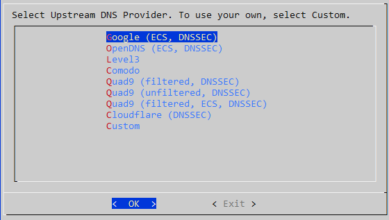
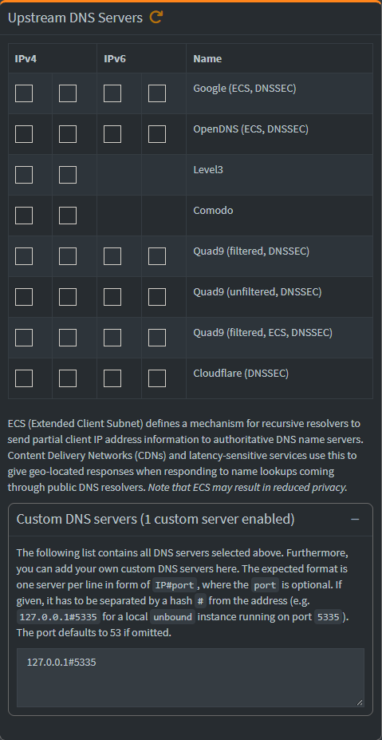

# Pi-hole + Unbound on a Raspberry Pi Zero 2 W

A network-wide DNS ad blocker (Pi-hole) that looks up website addresses itself (Unbound) instead of asking a public DNS provider, running on a Raspberry Pi Zero 2 W.

**Status:** Working and tested on one device (my Android phone). Not yet switched on for the whole network. See [Limits and what I did not test](#limits-and-what-i-did-not-test).

**Built:** 2026-11-20

## Goal

Run my own DNS server on a small, low-power board. Pi-hole answers the questions devices ask ("what is the address of this website?") and blocks known ad and tracking domains. Unbound sits behind it and finds answers by asking the internet's root servers directly, so no outside DNS provider sees every lookup.

## Hardware and software

| Item | Detail |
| --- | --- |
| Board | Raspberry Pi Zero 2 W (512 MB RAM, Wi-Fi only) |
| Name | `BananaCream` |
| Address | `192.168.1.189` (reserved on the modem) |
| OS | Raspberry Pi OS, Debian 13 "trixie", 32-bit (`armv7l`) |
| DNS blocker | Pi-hole |
| Resolver | Unbound 1.26.2 (Debian package) |
| Memory the OS sees | 424 MiB of the board's 512 MB |

## How it fits together

```
Phone (192.168.1.211)
   |  DNS question, port 53
   v
Pi-hole on BananaCream (192.168.1.189)
   |  blocked names get the answer 0.0.0.0
   |  allowed names are passed on, port 5335
   v
Unbound (127.0.0.1, same Pi)
   |  looks the answer up itself, starting from the root servers
   v
The internet's DNS servers
```

The home modem (`192.168.1.254`) still hands out addresses and DNS settings to every other device. Only the test phone uses the Pi-hole.

## What I did

### 1. Checked the Pi Zero 2 W was a reasonable fit

Pi-hole's official prerequisites list 512 MB of RAM as the minimum, which is exactly what this board has, so there is no spare room. The OS reports 424 MiB because part of the memory is reserved for the hardware. I decided to try it and measure memory after install. Raspberry Pi OS is on Pi-hole's supported list. The docs say "actively maintained versions" and do not name Debian 13, so I treated that as unconfirmed. The installer ran without refusing.

I also considered DietPi (a lighter OS). I stayed with Raspberry Pi OS because it is on the official supported list, the official install steps are written for it, and I had no evidence that memory would be a problem.

### 2. Gave the Pi a fixed address

Pi-hole needs a fixed address. I added a reservation (static lease) for the Pi's Wi-Fi in the modem under Local Network > LAN > Static Leases, using the address it already had.


The modem said the address was "already in use" and asked for a reboot. I restarted only the Pi. It came back on the same address.

### 3. Connected over SSH

I connected from my Windows PC with Command Prompt. PowerShell tried to open SSH in a separate app, so I used Command Prompt instead.

### 4. Installed Pi-hole

I downloaded the official installer (`wget -O basic-install.sh https://install.pi-hole.net`) and ran it with `sudo bash basic-install.sh`, instead of piping it straight into a shell, so the script was saved and could be looked at before it ran.


Choices during the install:

- **Upstream DNS:** Cloudflare (DNSSEC), as a temporary choice. Unbound did not exist yet, and pointing Pi-hole at a service that wasn't running would likely have stopped DNS working. I replaced it with Unbound in step 9.
- **Blocklist:** the default StevenBlack list (76,105 domains loaded).
- **Query logging:** on, so I could see who asked what and prove Unbound was being used.
- **Privacy level:** show everything. Pi-hole's docs say details hidden at a higher level cannot be recovered later by lowering the level, and I wanted the full log for testing.




### 5. Installed Unbound and hit a port clash

`sudo apt install unbound` installed the package but Unbound would not start. The log said:

```
error: can't bind socket: Address already in use for ::1 port 53
fatal error: could not open ports
```

Pi-hole was already using port 53, which is also Unbound's default.

### 6. Tested that my connection reaches the root servers

Pi-hole's Unbound guide recommends three tests before continuing, because some internet providers quietly redirect DNS traffic. All three passed (results in the table below).

### 7. Configured Unbound

I wrote `/etc/unbound/unbound.conf.d/pi-hole.conf` from the official Pi-hole guide (shortened two long comment blocks, no setting changes). The settings that fix the clash are:

```
interface: 127.0.0.1
port: 5335
```

`unbound-checkconf` reported no errors.

### 8. Switched off the resolvconf helper

The guide says the `unbound-resolvconf.service` helper can overwrite `/etc/resolv.conf` and cause odd behaviour. I ran `sudo systemctl disable --now unbound-resolvconf.service`. The guide's other two commands had nothing to act on: `/etc/resolvconf.conf` does not exist on this Pi, and there was no `resolvconf_resolvers.conf` file. I do not know exactly why the first is missing.

After that, `sudo service unbound restart` brought Unbound up on port 5335.

### 9. Pointed Pi-hole at Unbound

In Pi-hole's web page, Settings > DNS: unticked Cloudflare and entered `127.0.0.1#5335` as the only custom DNS server.



### 10. Tested from my PC and found the VPN in the way

From my Windows PC, `nslookup en.wikipedia.org 192.168.1.189` timed out with my VPN on and worked with it off. Asking the Pi from the Pi itself on its network address also worked. The VPN is the likely cause, but I did not look inside the VPN's settings to confirm.

### 11. Tested with a real device (my phone)

I did not change the modem's DNS setting. Instead I set the phone's own Wi-Fi settings to a static IP with both DNS boxes on the Pi-hole (`192.168.1.189`). The phone's IP, gateway and prefix length kept the values it already had. Setting both DNS boxes to the same address means the phone cannot quietly fall back to the modem and skip Pi-hole.


The phone's questions showed up in the Query Log, and the log showed them being forwarded to Unbound.


### 12. Tested blocking

`dig doubleclick.net @192.168.1.189` (run from the Pi) returned `0.0.0.0`, and the Query Log shows it blocked. This test came from the Pi, not the phone.


### 13. Tested a restart

After `sudo reboot`, both services were `active` without me starting anything, an Unbound lookup worked, and the phone loaded a page (slightly slower on first load, nothing I'd call noticeable, which is a casual impression, not a measurement).

## How I checked it

| Check | Command | Good result | What I got |
| --- | --- | --- | --- |
| Root server reachable (UDP) | `dig @198.41.0.4 . NS +norec +time=3` | `aa` flag, no `ra` | `flags: qr aa`, 13 answers |
| Root server reachable (TCP) | `dig @198.41.0.4 . NS +norec +tcp +time=3` | `aa` flag, no `ra` | `flags: qr aa`, 13 answers |
| Real root server | `dig @198.41.0.4 version.bind CH TXT +time=3` | `"ATLAS"` | `"ATLAS"` |
| Unbound answers | `dig pi-hole.net @127.0.0.1 -p 5335` | `NOERROR` and an address | `NOERROR` and an address |
| DNSSEC rejects a broken record | `dig fail01.dnssec.works @127.0.0.1 -p 5335` | `SERVFAIL` | `SERVFAIL` |
| DNSSEC accepts a good record | `dig +ad dnssec.works @127.0.0.1 -p 5335` | `NOERROR` and the `ad` flag | `NOERROR`, `flags: qr rd ra ad` |
| Pi-hole hands questions to Unbound | `sudo grep "forwarded www.google.com" /var/log/pihole/pihole.log` | forwarded to `127.0.0.1#5335` | forwarded to `127.0.0.1#5335` |
| Ad domain blocked | `dig doubleclick.net @192.168.1.189` | `0.0.0.0` | `NOERROR`, `0.0.0.0` |
| Services after a restart | `systemctl is-active unbound pihole-FTL` | `active` twice | `active`, `active` |

## Memory

Measured with `free -h` while the Pi was mostly idle:

| Point | `available` memory |
| --- | --- |
| Before Pi-hole | 311 MiB |
| After Pi-hole | 302 MiB |
| Pi-hole and Unbound running | 289 MiB (swap used: 152 KiB) |

These shift from moment to moment, and Unbound's memory use grows as it stores answers.

## What went wrong

1. **Unbound would not start.** Port clash with Pi-hole on port 53. Fixed by moving Unbound to `127.0.0.1` port 5335.
2. **DNS timed out from my PC.** My VPN was the likely cause. It worked with the VPN off.
3. **Two steps in the guide did not apply** because the files they edit are not on this system (see step 8).

## Limits and what I did not test

- **Only one device uses it.** The modem still tells every other device to use the modem for DNS. I have not made the network-wide change.
- **The address reservation is unproven.** The Pi kept its address after one restart, which modems often allow anyway. I did not test the reservation by forcing a clash.
- **IPv6 may bypass Pi-hole.** My modem has its own IPv6 DNS, and on an earlier lab machine that was asked first. I did not test this here.
- **Wi-Fi stability over days is unknown.** The Pi has no network port. A USB-to-Ethernet adapter is the fallback.
- **Memory was measured while idle,** and I will recheck after a few days of real use.
- **Restart speed is a single reading.** The first Unbound lookup after the restart took 320 ms. I have no earlier timing to compare it with.
- **Blocking was tested with one domain** (`doubleclick.net`).
- **The phone is on a static IP.** If the modem gave its address to another device there would be a clash. I will switch it back to automatic (DHCP) when testing ends.
- **The Pi has no backup.** If the memory card fails I would rebuild from these steps.
- **Debian 13 support is not confirmed in the official docs.** It installed and ran.

## Related projects

* Admin workstation: [custom-built PC](../custom-pc/README.md)
* Raspberry Pi Hardware: [Raspberry Pi 4 and Pi Zero 2 W](raspberry-pi/README.md) 
