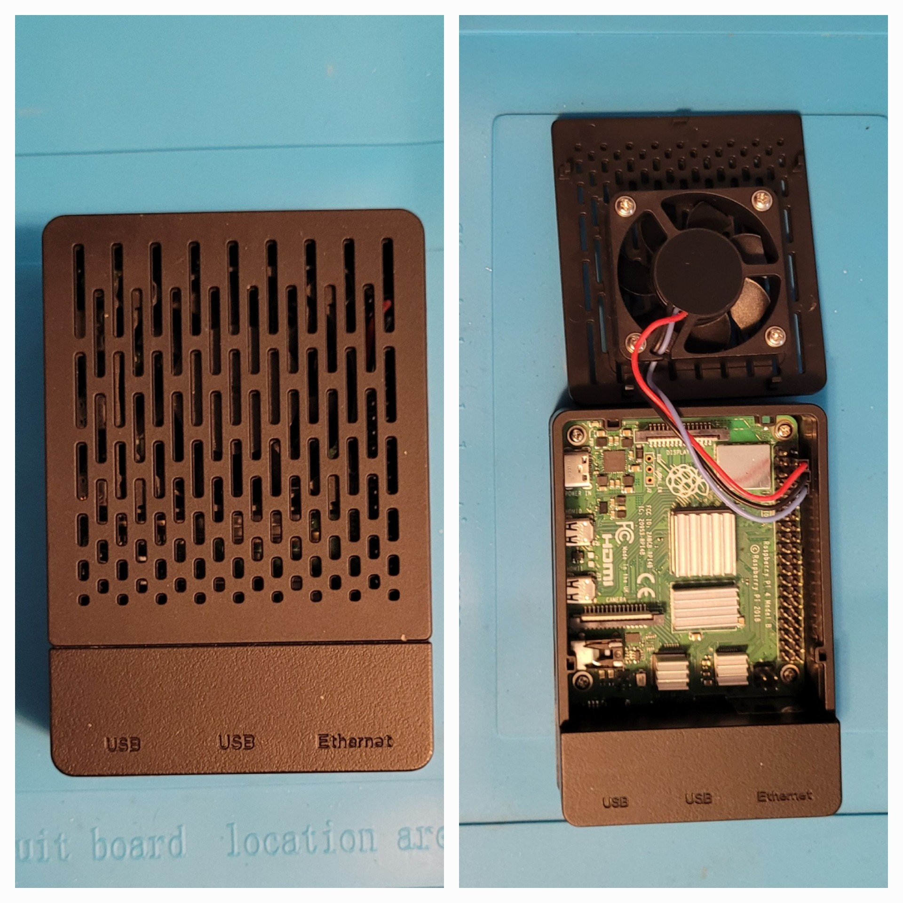
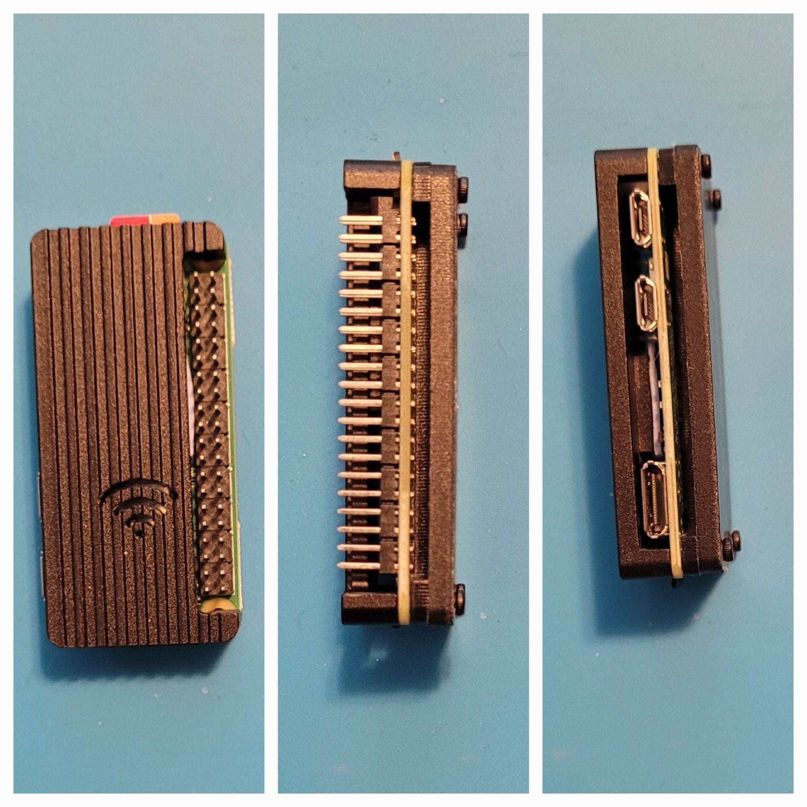

# Raspberry Pi 4 and Raspberry Pi Zero 2 W

Two Raspberry Pis that support my [homelab server](../server/README.md). Documented October 2026.

## Raspberry Pi 4 Model B

| | |
|---|---|
| **Model** | Raspberry Pi 4 Model B, 4GB RAM |
| **Case and cooling** | Black vented case with a fan mounted in the lid, plus heatsinks on the chips |
| **Storage** | Gigastone 32GB microSD card |
| **Operating system** | Raspberry Pi OS, based on Debian 13 "trixie" |
| **Network** | Wired to the ISP modem at `192.168.1.138/24` and also on Wi-Fi at `192.168.1.139/24` (read 2026-10-19) |
| **Idle temperature** | About 30 to 31°C with the case fan and heatsinks |

I installed Raspberry Pi OS onto the microSD card myself using Raspberry Pi Imager. I used my portable monitor, a keyboard, and a mouse to set it up, and this was my first time running it.

### How I checked

I opened a Terminal on the Pi and ran these read-only commands:

- `free -h` showed 3.7Gi of total memory, which means 4GB (some is reserved by the system).
- `grep PRETTY_NAME /etc/os-release` reported Debian GNU/Linux 13 (trixie), the base Raspberry Pi OS is built on.
- `hostname -I` and `ip -br addr` showed two addresses, `eth0` (wired) and `wlan0` (Wi-Fi).
- `vcgencmd measure_temp` gave the idle temperature.

The temperature was read while the Pi was idle. I haven't tested it under load. The modem assigns these addresses, so they can change.

## Raspberry Pi Zero 2 W

| | |
|---|---|
| **Model** | Raspberry Pi Zero 2 W (quad-core, 512MB RAM, built-in Wi-Fi) |
| **Header** | Soldered 40-pin GPIO header |
| **Case** | Black ribbed case with a Wi-Fi symbol on the lid |
| **Storage** | Gigastone 32GB microSD card |
| **Operating system** | Raspberry Pi OS 32-bit (Raspbian GNU/Linux 13 "trixie") |
| **Network** | Wi-Fi at `192.168.1.189` (read 2026-10-20) |
| **Idle temperature** | About 38°C (a single reading, a few minutes after booting) |

I also installed Raspberry Pi OS onto its microSD card using Raspberry Pi Imager.

I checked it with the same read-only commands as the Pi 4: `grep PRETTY_NAME /etc/os-release`, `uname -m` (which reported `armv7l`, meaning 32-bit), `ip -br addr`, and `vcgencmd measure_temp`. The modem assigns the address, so it can change.

## Planned roles

These come from my project plan and aren't built yet. The Pi Zero is meant for a Pi-hole and Unbound DNS filter, and the Pi 4 for Docker, self-hosted apps, and monitoring.

## Related projects

- [Proxmox homelab server](../server/README.md)
- [Custom-built PC](../custom-pc/README.md)
- [Backup storage](../backup-storage/README.md)

*Hardware addresses and serial numbers are not shown. IP addresses are private (home network) addresses.*
