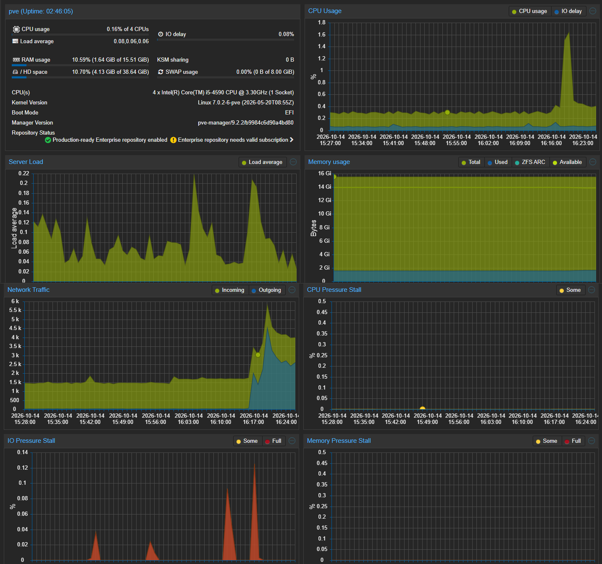
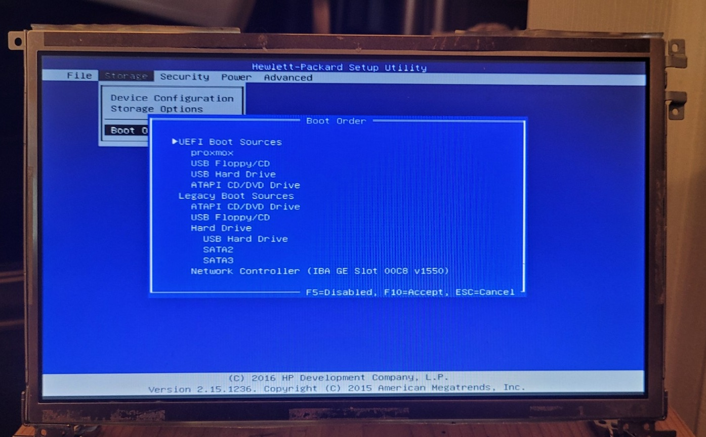
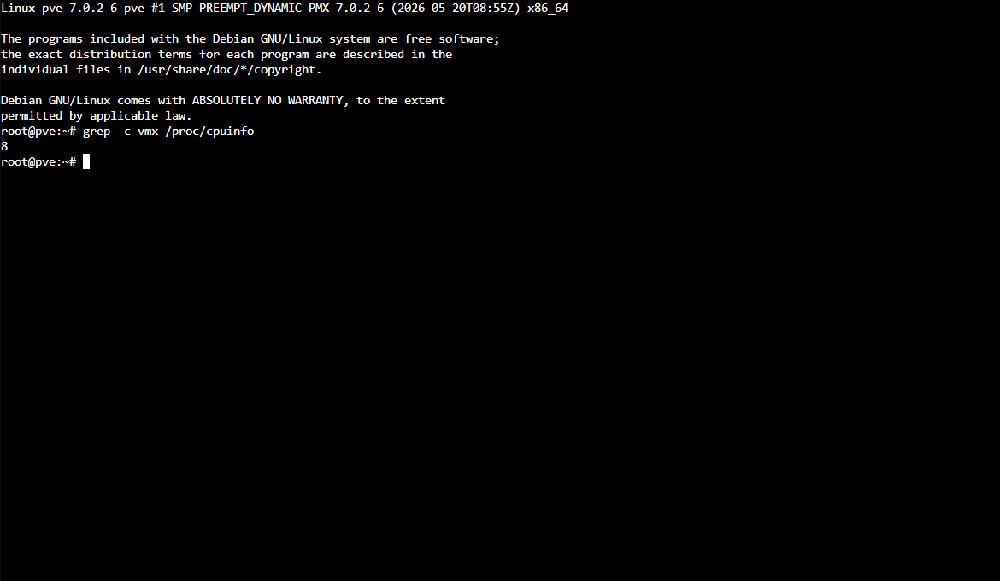
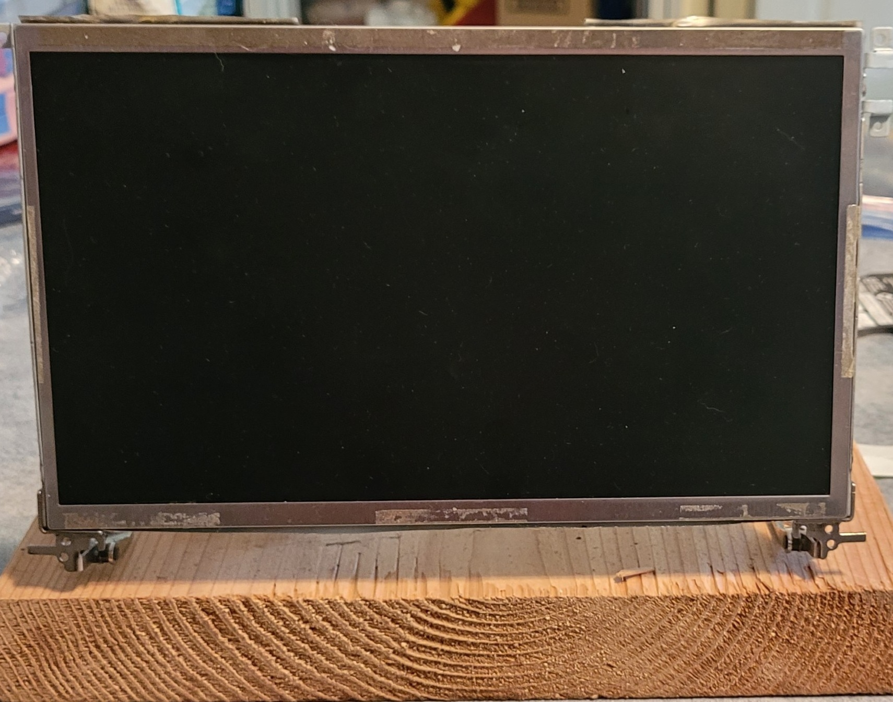
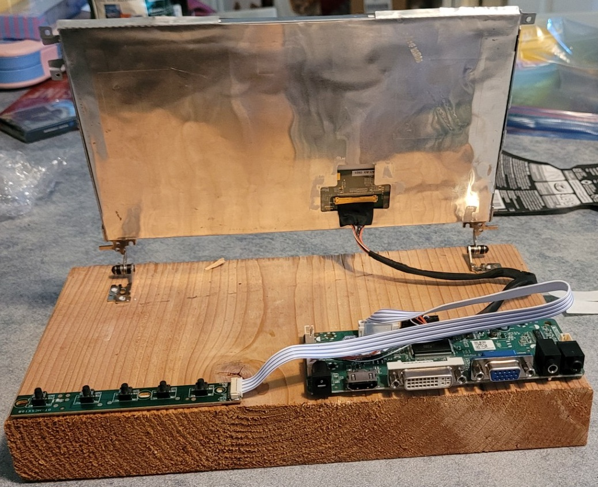
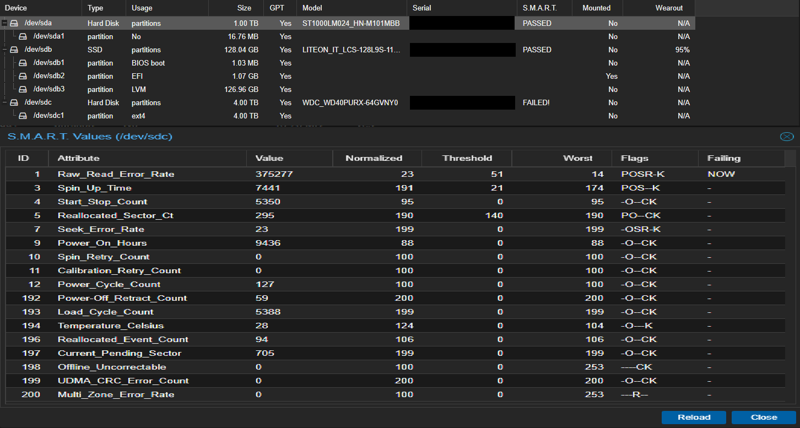
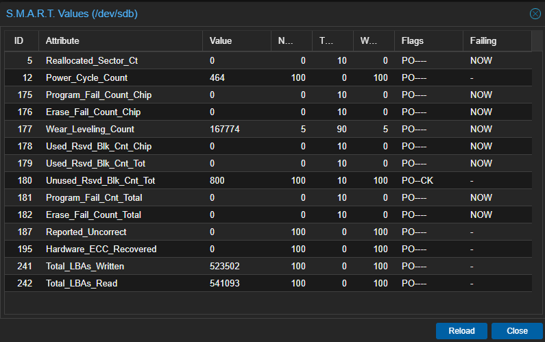

# Homelab Server: HP EliteDesk 800 G1 TWR running Proxmox VE

A repurposed HP desktop turned into the virtualization host for my homelab. The other lab projects run on it and link back here. Documented October 2026.

## Overview

|||
|-|-|
|**Machine**|HP EliteDesk 800 G1 TWR|
|**Role**|Proxmox VE virtualization host (hostname `pve`)|
|**Managed from**|My custom-built PC, through the Proxmox web interface|
| **Network** | `192.168.1.100/24`, gateway `192.168.1.254` (ISP modem/router) |

## Hardware

|Component|Details|Original or added|
|-|-|-|
|CPU|Intel Core i5-4590, 4 cores / 4 threads, 3.30GHz|Original|
|RAM|16GB DDR3-1600 (4x 4GB: three Samsung M378B5173QH0-CK0, one Micron 8JTF51264AZ-1G6E1), all running at 1600 MT/s|Original|
|Boot drive|LITEON LCS-128L9S-11, 128GB SSD (Proxmox OS)|Original|
|VM storage|Seagate ST1000LM024, 1TB HDD, salvaged from a broken laptop|**Added by me**|
|Network|Onboard Intel I217-LM Gigabit Ethernet|Original|
|Retired drive|WDC WD40PURX, 4TB HDD (failed health check, see below)|Original|

### Drive health (S.M.A.R.T.)

|Drive|Result|Notes|
|-|-|-|
|LITEON 128GB SSD|PASSED|463 power cycles. Wear\_Leveling\_Count normalized value is 5 (threshold 90), shown as 95% Wearout in Proxmox. 0 reallocated sectors and 0 program or erase failures. See Problems and fixes, item 3.|
|ST1000LM024 1TB|PASSED|0 reallocated sectors, 0 pending sectors, 29,346 power-on hours|
|WD40PURX 4TB|**FAILED**|Raw\_Read\_Error\_Rate failed (value 23, threshold 51), 295 reallocated sectors (94 reallocation events), 705 pending sectors. Disconnected.|

### Drives on hand, not installed

A 160GB and a 500GB laptop HDD, kept for future VM storage.

## Software

Proxmox VE 9.2.2 installed from an ISO on a USB drive onto the 128GB SSD. I chose Proxmox VE because I had read it was beginner friendly and easy to use.

Baseline screenshot of the Proxmox Summary page before any VMs were added:

## BIOS

The BIOS is an HP Setup Utility, version 2.15.1236.

* **Intel VT-x (Virtualization Technology):** it was **disabled** when I checked. I enabled it so Proxmox can run virtual machines, and verified it from the Proxmox shell with `grep -c vmx /proc/cpuinfo`, which returned a nonzero count (8).
* **VT-d and Data Execution Prevention:** reviewed and left unchanged. VT-d is only needed for passing hardware directly to a VM, and DEP is a security feature that should stay on.
* **Boot order:** the UEFI `proxmox` entry is first, then USB and optical drives, with legacy sources below and network boot last. I recorded it and changed nothing.

## Network

The server connects by Ethernet directly to the ISP-provided modem/router (made by Arcadyan, model not recorded). Proxmox's bridge `vmbr0` uses port `nic0`. I confirmed that `nic0` is the onboard I217-LM by matching its hardware address to the one shown in the BIOS.

## Local display

A salvaged 11.6" laptop LCD panel driven by a generic LCD controller board (HDMI, DVI and VGA inputs), mounted on its original hinges to a wooden base. It connects by VGA from the HP's onboard VGA port to the controller board's VGA port, with an output resolution of 1024x600. The monitor is no longer plugged into the server, because I manage the server from the Proxmox web interface. I've used it since to set up my Raspberry Pis.

## Problems and fixes

**1. Virtualization was disabled.** Proxmox installed fine, but VMs can't run without VT-x. I found the setting under Security > System Security in the HP BIOS, enabled it, saved, and confirmed it from the shell.

**2. A failing drive came with the machine.** Before putting anything on the 4TB WD Purple, I checked its S.M.A.R.T. data in Proxmox. It failed its health check and showed hundreds of unreadable sectors. The only copy of my media was on an external drive, so I first copied it to a second drive and verified the size and file count matched, then disconnected the 4TB and confirmed it no longer appears in Proxmox.

**3. The boot SSD reports a low wear indicator.** The Proxmox Disks table showed 95% Wearout for the boot SSD, so I opened its S.M.A.R.T. values. The Wear\_Leveling\_Count attribute has a normalized value of 5 against a threshold of 90, which usually means heavy wear. However, every bad-block counter (reallocated sectors, program failures, erase failures, used spare blocks) is 0, uncorrectable errors are 0, the spare-block count is at 800, and the drive still reports PASSED. Several attributes are also flagged "Failing NOW" despite zero counts, so I'm not sure this model's scores follow the usual scale, and I couldn't confirm what the wear number means. This drive doesn't report power-on hours.

**4. The server had the wrong gateway.** While setting up a Windows Server VM, I gave it a fixed address using 192.168.1.1 as the gateway, the value shown on Proxmox's network page, and it couldn't reach the network. The VM's automatic settings showed the real gateway as 192.168.1.254. From the Proxmox shell, nothing answered at 192.168.1.1 (the neighbor table marked it FAILED), while 192.168.1.254 replied. The server's IPv4 route used the wrong gateway, so `ping 8.8.8.8` failed. It could still download files over IPv6, which hid the problem. I changed the gateway on `vmbr0` to 192.168.1.254 in the Proxmox network settings and confirmed it with `ip route show default` and a successful `ping 8.8.8.8`. I haven't confirmed how the wrong value got there.

Lesson: test an address with ping before relying on it.

Decision: I'm keeping the SSD for now as a boot-only drive. VMs and logs will go on the 1TB drive, and I'll recheck the wear value periodically. If it drops further, I'll replace the SSD.

## Related projects

* Admin workstation: [custom-built PC](../custom-pc/README.md)
* Backup storage: [external drives](../backup-storage/README.md)
* Lab support hardware: [Raspberry Pi 4 and Pi Zero 2 W](../raspberry-pi/README.md)

\*Serial numbers, hardware addresses, and labels have been removed or covered in the images. IP addresses are private (home network) addresses.

