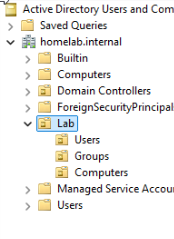
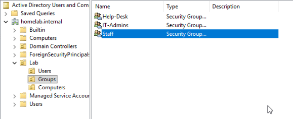
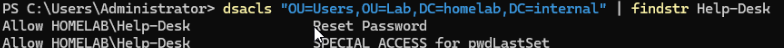
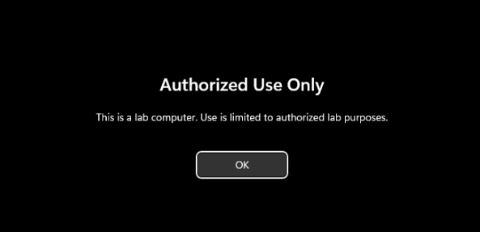
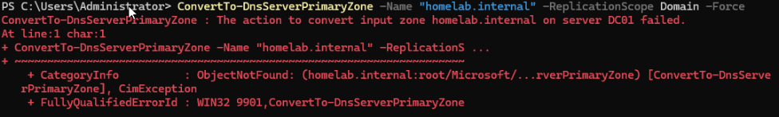
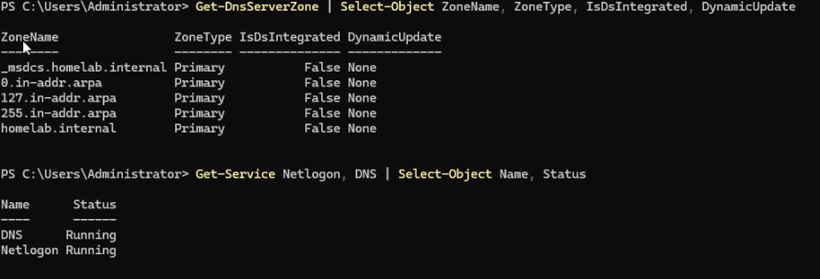
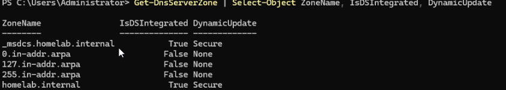

# Windows Server Active Directory Lab: Domain, Groups, Delegation, and Group Policy

A Windows Server 2025 domain controller and a Windows 11 client, both running as VMs on my [Proxmox server](../server/README.md). The lab covers building a domain, structuring it with OUs and groups, delegating a limited admin right, and applying a Group Policy to a domain-joined client. Documented October 2026.

## Overview

| | |
|---|---|
| **Domain** | `homelab.internal` (NetBIOS name HOMELAB) |
| **Domain controller** | DC01 (VM 100), Windows Server 2025 Standard Evaluation, Desktop Experience, fixed address `192.168.1.50/24` |
| **Client** | CLIENT01 (VM 101), Windows 11 Enterprise evaluation (26H2, build 26300, per the ISO file name) |
| **VM hardware** | 2 cores (host CPU type), 4GB RAM, 80GB thin-provisioned disk, UEFI with a virtual TPM 2.0, VirtIO disk and network, QEMU guest agent |
| **Storage** | A LVM-Thin pool (`vmdata`, about 980 GB usable) on the salvaged 1TB drive from the server project |
| **Licenses** | Microsoft evaluation editions. The Windows Server license was activated, with about 175 days remaining on 2026-10-27. The Windows 11 trial is 90 days per Microsoft's page, and I haven't checked it on the VM. |

I chose `.internal` for the domain name because ICANN has reserved it for private use. `.local` is reserved for multicast DNS and can cause lookup problems.

## What I built

1. **VM storage.** Wiped the 1TB drive and created an LVM-Thin pool for VM disks, so they stay off the boot SSD.
2. **Windows Server install.** Windows can't see a VirtIO disk without a driver, so I loaded the `vioscsi` driver from the VirtIO ISO at the disk-selection screen, then installed the VirtIO guest tools.
3. **Domain controller.** Gave DC01 a fixed address, renamed it, installed Active Directory Domain Services, and promoted it to a new forest. I didn't enable DHCP, since the home modem already hands out addresses.
4. **Structure.** An OU called `Lab` with `Users`, `Groups`, and `Computers` inside it. Security groups `IT-Admins`, `Help-Desk`, and `Staff`. Four test users (one admin, one help desk, two staff), each placed in a group.
5. **Delegation.** The `Help-Desk` group can reset passwords in the `Lab > Users` OU and has no other rights there.
6. **Admin group (lab shortcut).** `IT-Admins` is a member of Domain Admins. In a real company I would keep that group much smaller.
7. **Group Policy.** A policy named `Lab-Computer-Logon-Banner`, linked to `Lab > Computers`, shows a sign-in message titled "Authorized Use Only".
8. **Client.** Built a Windows 11 Enterprise VM, pointed its DNS at DC01, joined it to the domain, moved its computer account into `Lab > Computers`, and signed in as a domain user from the Staff group. The banner appeared before sign-in.

## How I verified it

| Check | Command | Result |
|---|---|---|
| Domain exists | `Get-ADDomain` | DNSRoot `homelab.internal`, NetBIOSName `HOMELAB` |
| DC registered in DNS | `nslookup dc01.homelab.internal` | `192.168.1.50` |
| Delegation is limited | `dsacls "OU=Users,OU=Lab,..." \| findstr Help-Desk` | Only Reset Password and write access to `pwdLastSet` |
| Nested admin rights | `Get-ADGroupMember "Domain Admins" -Recursive` | The built-in Administrator and the admin test user |
| Policy is linked | `Get-GPInheritance -Target "OU=Computers,OU=Lab,..."` | `Lab-Computer-Logon-Banner` linked, inheritance not blocked |
| Policy contents | `Get-GPOReport` (XML) | Both the title and the message text are present |
| Client signed in to the domain | `whoami` | `homelab\<staff user>` |

The Settings tab in Group Policy Management was blocked by Windows Server's Internet Explorer Enhanced Security Configuration, so I read the policy with `Get-GPOReport` and chose not to lower the server's security to view it.

## Problems and fixes

**1. The server had the wrong gateway.** A fixed address for DC01 failed to reach the network, because the Proxmox host's gateway was set to an address that nothing answered at. It's covered in the [server write-up](../server/README.md).

**2. The client asked the modem's IPv6 DNS server first.** After pointing the client at DC01, `nslookup dc01.homelab.internal` was answered by the modem, which said the domain doesn't exist. `ipconfig /all` showed the modem's IPv6 DNS address listed ahead of DC01. Asking DC01 directly worked. I turned IPv6 off on the client's adapter. That's a lab shortcut, and I haven't checked what else on that build depends on it.

**3. The domain join couldn't find a domain controller.** The error was "An Active Directory Domain Controller could not be contacted". Its Details said DNS reported that the name `_ldap._tcp.dc._msdcs.homelab.internal` doesn't exist. That record tells clients where the domain controller is. On DC01, both DNS zones were plain file-based zones with dynamic updates off, so DC01 couldn't register the record. DNS Server event 4000 ("unable to open Active Directory") was logged twice on the day I promoted DC01, and `dnscmd /EnumDirectoryPartitions` reported a count of 0. `ConvertTo-DnsServerPrimaryZone` failed with error 9901, which means the directory partition doesn't exist, and `dnscmd /CreateBuiltinDirectoryPartitions` returned `ERROR_INVALID_DATA`. I took a snapshot before touching anything. Restarting the DNS service created both partitions (the count went to 2). I then converted both zones to Active Directory-integrated with `ConvertTo-DnsServerPrimaryZone` and set secure dynamic updates with `Set-DnsServerPrimaryZone`, and both zones showed as integrated with secure updates. Both zones then showed as Active Directory-integrated with secure dynamic updates. `nltest /dsregdns` registered the records, the SRV lookup returned DC01, and the join succeeded. My best explanation is that DNS started before Active Directory was ready and never retried. I haven't confirmed that.

## Limits

- There's one domain controller, so there's no redundancy. The snapshots live on the same 1TB drive as the VMs, so they protect against mistakes and not against that drive failing.
- IPv6 is turned off on the client, and `IT-Admins` is in Domain Admins. Both are lab shortcuts.
- Both operating systems are evaluation editions, and DC01 needs rebuilding or renewing around April 2027.
- DC01 doesn't start automatically after a server restart, because I left "Start at boot" off.

## Related projects

- [Proxmox homelab server](../server/README.md)
- [Custom-built PC](../custom-pc/README.md)
- [Raspberry Pi 4 and Pi Zero 2 W](../raspberry-pi/README.md)
- [Backup storage](../backup-storage/README.md)

*Passwords, product keys, serial numbers, hardware addresses, and internet addresses tied to my home connection are not shown.*
