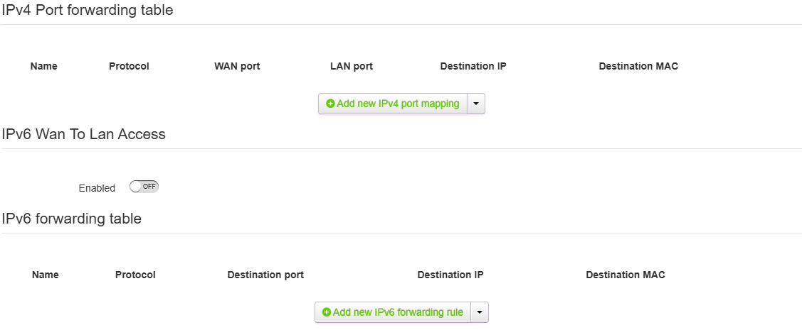
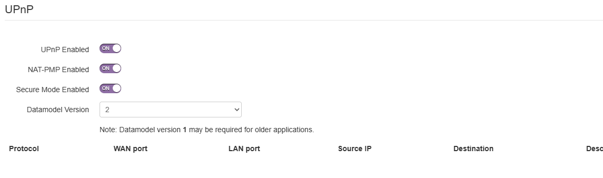
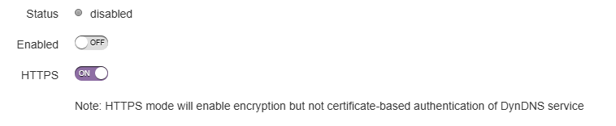
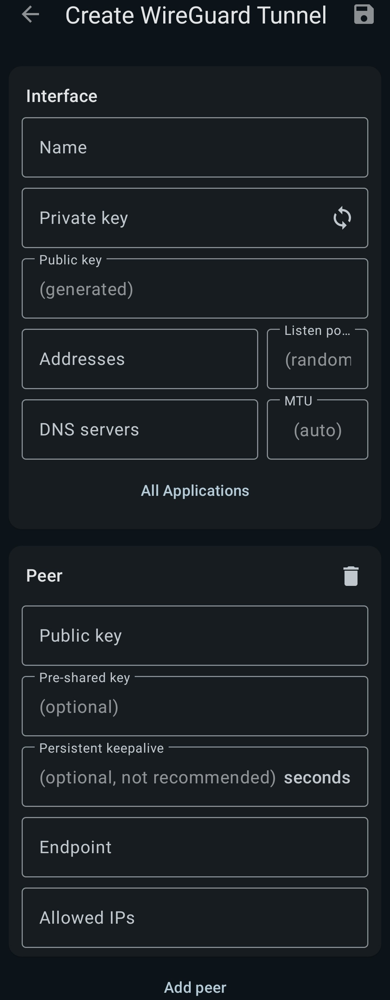
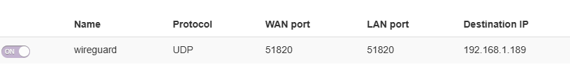
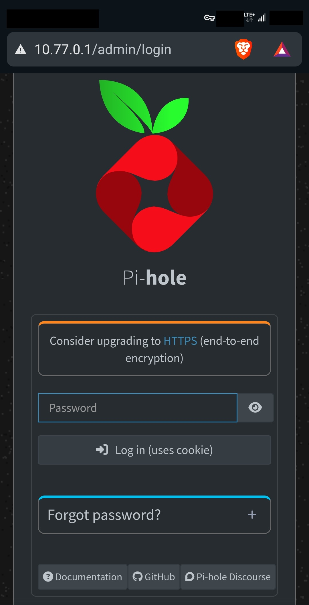
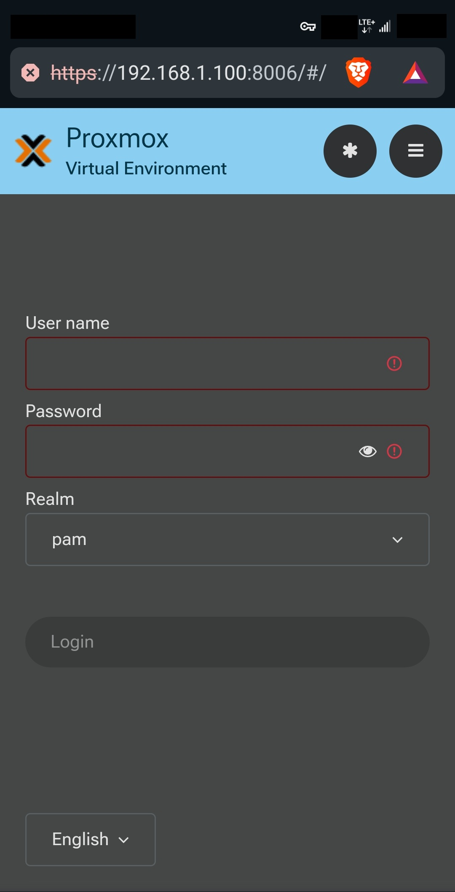

# WireGuard remote access on a Raspberry Pi Zero 2 W

A private tunnel from my Android phone into my home lab, running on the Raspberry Pi Zero 2 W (`BananaCream`). Over mobile data, my phone can reach the Pi and the Proxmox server's login page, and nothing else.

**Status:** Working and tested from mobile data with one device (my phone). Only two addresses are reachable through the tunnel. See [Limits and what I did not test](#limits-and-what-i-did-not-test).

**Built:** 2026-11-21 to 2026-11-22

## Goal

Check on my Pi-hole and Proxmox server from anywhere, without opening the lab to the whole internet. I wanted a tunnel I configured myself, so I chose plain WireGuard, which means making the keys and the settings by hand, over Tailscale. Tailscale was my fallback.

## Hardware and software

| Item | Detail |
| --- | --- |
| Board | Raspberry Pi Zero 2 W (Wi-Fi only), named `BananaCream`, address `192.168.1.189` |
| OS | Raspberry Pi OS, Debian 13 "trixie", 32-bit, kernel `6.18.60+rpt-rpi-v7` |
| VPN | WireGuard, `wireguard-tools` v1.0.20210914 (Debian package). The kernel already includes the WireGuard module. |
| Firewall tool | `iptables` v1.8.11 (`nf_tables`) |
| Tunnel addresses | Pi `10.77.0.1`, phone `10.77.0.2` (a private range I picked, different from my home network's `192.168.1.x`) |
| Port | UDP 51820 |
| Client | WireGuard app on an Android phone |
| Server reached | Proxmox host at `192.168.1.100` (web page on port 8006) |

## How it fits together

```
Phone (10.77.0.2), on mobile data
   |  encrypted WireGuard tunnel, UDP 51820
   v
Home modem: forwards UDP 51820 to the Pi only
   v
Pi (BananaCream): tunnel address 10.77.0.1
   |  firewall rules allow tunnel traffic to Proxmox only
   v
Proxmox host (192.168.1.100)
```

## What I did

### 1. Checked the fit and chose WireGuard first

The Pi has 512 MB of RAM, which is tight, and it was already running Pi-hole and Unbound. Tailscale's own docs list my OS as supported. WireGuard is part of the Linux kernel, so I expected it to use very little memory. I picked plain WireGuard because it gives more hands-on work (keys, settings, firewall) and kept Tailscale as a fallback.

### 2. Checked that my network could support it

Plain WireGuard needs a port forwarded on the modem and a public address.

- The modem's internet-side address is a public address. It isn't in a private range, and it isn't in the range some providers use to share one address between customers. It also matched the address the internet sees, which I checked from my phone on home Wi-Fi.
- The modem has a Port Mapping page with fields for the protocol, the ports and the destination device.
- The modem's DMZ was off, and I left it off.





I only checked IPv4. These checks do not prove that incoming connections get through my provider, only a real test from outside can.

### 3. Installed WireGuard

`modinfo wireguard` showed the kernel already has the module (`wireguard.ko.xz`). I previewed the install first with `sudo apt install -s wireguard`. It would install only two packages, with nothing that builds modules. Then `sudo apt install wireguard`.

### 4. Made the Pi's keys

Each device has a private key (a secret) and a public key (safe to share). I made the Pi's pair inside a single `sudo sh -c '...'` so the `umask 077` inside it applies. The files are readable only by root, and the private key was never printed. Private keys never left their own devices.

### 5. Wrote the Pi's settings file

`/etc/wireguard/wg0.conf` first held the tunnel address, the port, and a line that loads the private key from its file. The file is locked to root.

### 6. Set up the phone

In the phone's WireGuard app I chose "Create from scratch". The app made the phone's keys on the phone. The phone's address is `10.77.0.2/32`, and its peer is the Pi. Each side holds the other's public key, which I copied over as a text file. I did not retype them. I compared the first and last four characters on each side. The Pi's `[Peer]` section lists the phone's key and `AllowedIPs = 10.77.0.2/32`.



### 7. Tested on my home Wi-Fi first

With the phone's Endpoint set to the Pi's home address, I started the tunnel and loaded `http://10.77.0.1/admin`, which only exists inside the tunnel. The Pi showed a handshake 48 seconds old and data moving both ways.

### 8. Started it at boot

`sudo systemctl enable wg-quick@wg0`, then a reboot. The service came back by itself and the phone reconnected.

### 9. Added the port forward on the modem

UDP only, port 51820 to the Pi's address, with the Source IP left blank. The DMZ and IPv6 stayed off. The Destination MAC column stayed empty, and it did not stop the rule working.



### 10. The first mobile-data test failed

With the phone on mobile data, the tunnel wouldn't connect. The Pi showed no handshake. I ran `sudo timeout 90 tcpdump -ni wlan0 udp port 51820` on the Pi while the phone tried, and it captured 0 packets. I checked that the Endpoint matched the modem's address, looked at the modem's firewall level (low), and read forum reports about port forwarding problems on my modem model. I could not prove a cause, so I took everything out: the forwarding rule, WireGuard on the Pi, the keys and settings, and the phone's tunnel and app.

### 11. A detour into Tailscale

I installed Tailscale from its official repository, but its sign-in needs an account with a third-party provider (Google, Microsoft and others), and I didn't want that. I did not complete the setup and stopped its service. While it was installed, the modem showed a UPnP rule for UDP port 41641, which is Tailscale's default port. It was most likely made automatically by Tailscale on the Pi. I never saw the rule's destination, so this is likely and not proven. The rule disappeared when I stopped Tailscale.

### 12. Rebuilt WireGuard with new keys

New keys on both ends, then the same steps. Three mistakes along the way:

- The Pi's key files were missing, because I'd skipped the key-creation step. `cat` of the missing file gave "No such file or directory".
- `wg-quick down wg0` failed with "wg0 is not a WireGuard interface", because the tunnel hadn't been started. `wg-quick up wg0` was all that was needed.
- I typed `192.168.0.189` in the phone's Endpoint, not `192.168.1.189`. There was no handshake and no error message at all. Fixing the one digit made the handshake appear.

### 13. The mobile-data test worked

With Wi-Fi off, the tunnel on and my other VPN off, the phone loaded `http://10.77.0.1/admin`, and the Pi showed a handshake 22 seconds old. The address the Pi recorded for the phone was an outside address, not a home one.



I think the first failed test was mostly a test mistake. I believe I had browsed to the Pi's home address (`192.168.1.189`) instead of the tunnel address, which can't work away from home. I can't confirm which address I typed, because that tunnel is deleted.

### 14. Limited the tunnel to Proxmox

I wanted the phone to reach the Pi and Proxmox and nothing else. I enforced that in two places.

- **On the phone:** the peer's Allowed IPs hold only `10.77.0.1/32` and `192.168.1.100/32`.
- **On the Pi:** `PostUp` and `PostDown` lines in `wg0.conf` switch IP forwarding on only while the tunnel is up. They accept tunnel traffic going to `192.168.1.100`, accept replies back into the tunnel, drop everything else, and rewrite the sender (masquerade) only for traffic to `192.168.1.100`, so Proxmox can reply.



To test the Pi's rules, I temporarily added `glpi01` (`192.168.1.60`) to the phone's Allowed IPs, and its web page failed to load. The Pi's last drop rule counted 18 packets (1,080 bytes). I then removed `glpi01` from the phone's list. After a reboot, the rules, the tunnel and Proxmox's page all came back by themselves.

## How I checked it

| Check | What I ran or did | A good result is | What I got |
| --- | --- | --- | --- |
| Kernel has WireGuard | `modinfo wireguard` | a module file listed | `wireguard.ko.xz` listed |
| Tools installed | `wg --version` | a version | v1.0.20210914 |
| Tunnel up | `sudo wg show` | `listening port: 51820` | yes |
| Home Wi-Fi test | phone loads `http://10.77.0.1/admin` | login page, handshake | loaded, handshake 48 s ago |
| Start at boot | `systemctl is-enabled wg-quick@wg0` | `enabled` | `enabled` |
| Mobile data test | Wi-Fi off, phone loads `http://10.77.0.1/admin` | login page, new handshake | loaded, handshake 22 s ago |
| Proxmox over the tunnel | phone loads `https://192.168.1.100:8006` | login page | loaded, first rule counted 1,941 packets |
| Narrow limit | `glpi01` temporarily added to the phone's list | page fails, drop rule counts | failed, drop rule counted 18 packets |
| Rules after a reboot | `sudo iptables -S FORWARD` and the nat table | four forwarding rules, one masquerade rule | all present |

## Memory

Measured with `free -h` on a mostly idle Pi, in `available`:

| Point | Available |
| --- | --- |
| Before WireGuard | 295 MiB |
| Tunnel running | 293 MiB |
| Rebuilt and running at boot | 292 MiB |

## What went wrong

1. **No handshake from mobile data the first time.** Probably the test address, not the network (step 13), but not proven.
2. **A missing key file,** from skipping a step.
3. **A one-digit typo** in the phone's Endpoint, with no error message.
4. **A port opened automatically by UPnP** when Tailscale was installed (step 11).

## Limits and what I did not test

- **My public address may change,** since the modem gets it automatically. If it does, the phone's Endpoint stops working until it's updated. I haven't checked how often it changes. The modem has a dynamic DNS feature, switched off, and I haven't looked at its options.
- **Revoking a lost phone is untested.** I would remove the phone's `[Peer]` section on the Pi. I haven't tried it. My phone has a strong lock-screen passcode.
- **Only one device uses the tunnel.**
- **No SSH to the Pi over the tunnel yet.**
- **Proxmox sees the Pi, not the phone,** as the source of connections from the tunnel, because of the masquerade, so its logs won't name the phone.
- **The Pi has no other firewall rules.** Devices on my home Wi-Fi can still reach its admin pages directly.
- **UPnP is still switched on in the modem.** Other programs on my network could open ports the same way. I have not decided whether to switch it off.
- **Wi-Fi only.** If the Pi loses its Wi-Fi, the tunnel and Pi-hole both stop.
- **Speed, battery use and long-term stability are not measured.**
- **I only tested IPv4.**
- **The modem's behaviour is partly unknown.** I found forum reports of port forwarding problems on my model, but I haven't verified them, and my own forwarding worked in the end.

## Related projects

- [Pi-hole and Unbound DNS](../pihole-unbound/README.md): runs on the same Pi, and is the first thing I check over the tunnel.
- [Raspberry Pi 4 and Pi Zero 2 W](../raspberry-pi/README.md): the hardware this runs on.
- [Proxmox homelab server](../server/README.md): the server the tunnel reaches.
